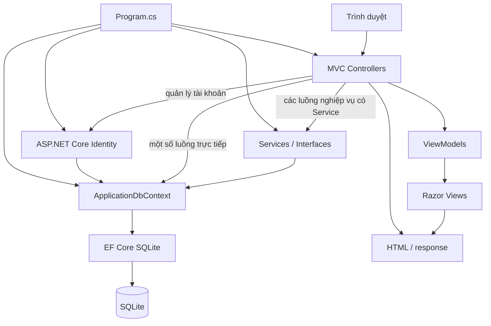

# Cấu trúc hệ thống ConstructionProjectManagement

Tài liệu được lập từ mã nguồn hiện có trong project. Cây dưới đây liệt kê từng thư mục và file hiện diện; phần chú thích mô tả vai trò dựa trên nội dung, khai báo kiểu, route/view, cấu hình hoặc metadata tương ứng.

> **Phạm vi kiểm kê:** thư mục gốc vật lý là `MyProject-main` (tên project theo `.csproj` là `ConstructionProjectManagement`). Không tìm thấy `.sln` hoặc `.slnx`; Solution hiện chỉ có một project. `bin/` và `obj/` là thư mục build sinh tự động nên được loại khỏi cây chi tiết. Không thấy `.vs/`, `.git/` hoặc `node_modules/` trong project. Các file SQLite và file WAL/SHM đang có được giữ trong cây; nội dung dữ liệu nhị phân không được đưa vào tài liệu.

## Cây thư mục

```text
ConstructionProjectManagement/                                      # Thư mục gốc project web ASP.NET Core MVC
├── AGENTS.md                                                        # Hướng dẫn kiến trúc, phạm vi nghiệp vụ và quy ước cho tác nhân phát triển
├── appsettings.Development.json                                     # Thiết lập ứng dụng riêng cho môi trường Development; không chứa cấu hình kết nối trong file hiện tại
├── appsettings.json                                                 # Cấu hình log, AllowedHosts và kết nối EF Core tới SQLite (không lặp giá trị cấu hình tại đây)
├── ConstructionProjectManagement.csproj                             # Project .NET 10; khai báo Identity, EF Core SQLite, EF Tools và loại migration SQL Server khỏi biên dịch
├── Program.cs                                                       # Khởi tạo host, đăng ký MVC/Identity/DbContext/service, middleware, route và gọi khởi tạo dữ liệu
├── README.md                                                        # Giới thiệu, hướng dẫn chạy và liên kết tài liệu; phần mô tả SQL Server không khớp cấu hình runtime SQLite hiện tại
├── PROJECT_STRUCTURE.md                                             # Tài liệu này: cây thư mục, vai trò file và tổng quan kiến trúc
├── Controllers/                                                     # Điểm nhận HTTP request, điều phối nghiệp vụ và trả View/response
│   ├── AccountController.cs                                         # AccountController: liệt kê/tạo/sửa tài khoản, cập nhật hồ sơ và thao tác vai trò qua ASP.NET Core Identity
│   ├── CompletionController.cs                                      # CompletionController: tổng hợp chi phí/bàn giao, ghi chi phí, tạo/xác nhận hồ sơ bàn giao và lưu trữ hồ sơ
│   ├── ConstructionLogsController.cs                                # ConstructionLogsController: xem, tạo và sửa nhật ký thi công theo dự án
│   ├── ContractsController.cs                                       # ContractsController: CRUD hợp đồng, xem chi tiết và tải lên/tải xuống tài liệu hợp đồng
│   ├── DashboardController.cs                                       # DashboardController: lấy dữ liệu tổng quan qua DashboardService và hiển thị dashboard
│   ├── EmployeesController.cs                                       # EmployeesController: danh sách, tạo và cập nhật hồ sơ nhân viên
│   ├── EquipmentController.cs                                       # EquipmentController: quản lý thiết bị, bàn giao/thu hồi và cập nhật trạng thái bảo trì
│   ├── HomeController.cs                                            # HomeController: trang chủ, trang quyền riêng tư và trang lỗi
│   ├── MaterialsController.cs                                       # MaterialsController: danh mục vật tư, yêu cầu, duyệt/từ chối và xuất vật tư
│   ├── ProgressController.cs                                        # ProgressController: xem/cập nhật tiến độ công việc và cung cấp dữ liệu biểu đồ
│   ├── ProjectMembersController.cs                                  # ProjectMembersController: xem thành viên dự án và xử lý thêm thành viên
│   ├── ProjectsController.cs                                        # ProjectsController: danh sách, chi tiết, tạo và cập nhật dự án
│   ├── QualityController.cs                                         # QualityController: sự cố, tạo/phản hồi RFI và tạo/ghi kết quả nghiệm thu
│   ├── TasksController.cs                                           # TasksController: danh sách, chi tiết, tạo và cập nhật công việc
│   ├── TeamsController.cs                                           # TeamsController: danh sách/tạo đội thi công và thêm thành viên đội; truy cập DbContext trực tiếp
│   └── WbsController.cs                                             # WbsController: xem cây WBS, tạo giai đoạn và thêm hạng mục công việc
├── Data/                                                            # Truy cập dữ liệu, cấu hình EF Core và khởi tạo cơ sở dữ liệu
│   ├── ApplicationDbContext.cs                                      # ApplicationDbContext: DbSet, ánh xạ quan hệ/khóa/chính sách xóa và kế thừa IdentityDbContext
│   ├── DbInitializer.cs                                             # DbInitializer: áp dụng migration, tạo vai trò/tài khoản Admin tùy cấu hình và seed dữ liệu mẫu tùy chọn
│   └── Databases/                                                   # File SQLite cục bộ và quy tắc loại trừ file database khỏi Git
│       ├── .gitignore                                               # Loại các file .db, .db-shm và .db-wal khỏi Git
│       ├── ConstructionProjectManagement.db                         # Cơ sở dữ liệu SQLite nhị phân đang được cấu hình cho ứng dụng
│       ├── ConstructionProjectManagement.db-shm                     # Vùng shared-memory SQLite dùng cùng cơ chế WAL; dữ liệu runtime tạm
│       └── ConstructionProjectManagement.db-wal                     # Write-ahead log SQLite chứa thay đổi chưa checkpoint; dữ liệu runtime tạm
├── docs/                                                            # Tài liệu nghiệp vụ, thiết kế, kiểm thử, quản lý dự án và sơ đồ
│   ├── 01_Business_Analysis/                                        # Đặc tả phạm vi và quy tắc của 12 nhóm nghiệp vụ
│   │   ├── Business_01_Accounts_and_Authorization.md                # Phân tích quản lý tài khoản, vai trò và quyền truy cập
│   │   ├── Business_02_Project_Management.md                        # Phân tích quản lý dự án
│   │   ├── Business_03_Contracts_and_Documents.md                   # Phân tích hợp đồng và tài liệu dự án
│   │   ├── Business_04_Phases_and_WBS.md                            # Phân tích giai đoạn dự án và cấu trúc WBS
│   │   ├── Business_05_Task_Management.md                           # Phân tích quản lý công việc
│   │   ├── Business_06_Schedule_and_Progress.md                     # Phân tích kế hoạch, lịch và theo dõi tiến độ
│   │   ├── Business_07_Human_Resources_and_Teams.md                # Phân tích nhân sự, phòng ban và đội thi công
│   │   ├── Business_08_Materials.md                                 # Phân tích vật tư và yêu cầu/cấp phát vật tư
│   │   ├── Business_09_Equipment.md                                 # Phân tích thiết bị và bàn giao thiết bị
│   │   ├── Business_10_Construction_Logs.md                         # Phân tích nhật ký thi công
│   │   ├── Business_11_Quality_Rfi_Inspection.md                    # Phân tích sự cố, yêu cầu làm rõ (RFI) và nghiệm thu
│   │   └── Business_12_Cost_Completion_Handover_Reports.md          # Phân tích chi phí, hoàn thành, bàn giao và báo cáo
│   ├── 02_System_Design/                                            # Tài liệu thiết kế tổng thể và mô tả phân lớp hệ thống
│   │   ├── Code_Structure.md                                        # Mô tả các tầng Controller, Service, Model, ViewModel, Data và View
│   │   ├── System_Architecture.md                                   # Mô tả kiến trúc và luồng xử lý; sơ đồ tài liệu này có nhắc SQL Server nên cần đối chiếu cấu hình runtime
│   │   └── System_Design.md                                         # Tài liệu thiết kế hệ thống ở mức tổng quát
│   ├── 03_Database/                                                 # Tài liệu mô hình và từ điển cơ sở dữ liệu
│   │   ├── Database_Design.md                                       # Mô tả thiết kế database; nội dung ghi SQL Server, khác với SQLite trong cấu hình/runtime hiện tại
│   │   └── Data_Dictionary.md                                       # Từ điển rút gọn các bảng/trường dữ liệu
│   ├── 04_Testing/                                                  # Tài liệu kế hoạch, ca kiểm thử và báo cáo lỗi
│   │   ├── Bug_Report.md                                            # Ghi nhận báo cáo lỗi
│   │   ├── Test_Cases.md                                            # Các ca kiểm thử nghiệp vụ được mô tả bằng tài liệu
│   │   └── Test_Plan.md                                             # Kế hoạch kiểm thử
│   ├── 05_Project_Management/                                       # Tài liệu kế hoạch và tiến độ triển khai project
│   │   ├── Implementation_Progress.md                               # Theo dõi giai đoạn và tình trạng triển khai
│   │   └── Initial_Project_Plan.md                                  # Kế hoạch dự án ban đầu, phạm vi và kiến trúc dự kiến
│   ├── 06_Diagrams/                                                 # Sơ đồ Mermaid dạng file .mmd cho kiến trúc, dữ liệu và quy trình
│   │   ├── 01_Project_File_Structure.mmd                           # Sơ đồ cấu trúc file/project
│   │   ├── 02_System_Architecture.mmd                               # Sơ đồ thành phần kiến trúc; hiện mô tả SQL Server, cần đối chiếu SQLite runtime
│   │   ├── 03_Code_Dependencies.mmd                                 # Sơ đồ phụ thuộc giữa Program, Controller, Service, Identity và DbContext
│   │   ├── 04_Database_ERD.mmd                                      # Sơ đồ ERD các thực thể và quan hệ dữ liệu
│   │   ├── 05_Use_Case_Diagram.mmd                                  # Sơ đồ use case
│   │   ├── 06_Class_Diagram.mmd                                     # Sơ đồ lớp
│   │   ├── 07_Process_01_Project_Planning.mmd                       # Quy trình lập kế hoạch dự án
│   │   ├── 08_Process_02_Task_Execution.mmd                         # Quy trình thực hiện công việc
│   │   ├── 09_Process_03_Material_Management.mmd                    # Quy trình quản lý vật tư
│   │   ├── 10_Process_04_Progress_Tracking.mmd                      # Quy trình cập nhật/theo dõi tiến độ
│   │   ├── 11_Process_05_Inspection_Acceptance.mmd                  # Quy trình nghiệm thu
│   │   ├── 12_Process_06_Project_Handover.mmd                       # Quy trình bàn giao dự án
│   │   ├── 13_Sequence_Create_Project.mmd                           # Sequence diagram tạo dự án
│   │   ├── 14_Sequence_Task_Assignment.mmd                          # Sequence diagram giao việc
│   │   ├── 15_Sequence_Material_Issue.mmd                           # Sequence diagram cấp phát vật tư
│   │   ├── 16_Sequence_Progress_Update.mmd                          # Sequence diagram cập nhật tiến độ
│   │   ├── 17_Sequence_Inspection.mmd                               # Sequence diagram nghiệm thu
│   │   ├── 18_Sequence_Handover.mmd                                 # Sequence diagram bàn giao
│   │   └── README_Diagrams.md                                       # Danh mục và hướng dẫn đọc các sơ đồ Mermaid
│   └── 07_Testing/                                                  # Ma trận kiểm thử tích hợp theo quy trình
│       └── Integration_Test_Matrix.md                               # Ma trận test tích hợp và kết quả smoke test được ghi nhận
├── Migrations/                                                       # Migration EF Core SQLite đang được biên dịch và snapshot model tương ứng
│   ├── 20261111092125_InitialSqlite.cs                              # Migration InitialSqlite: tạo các bảng Identity và bảng nghiệp vụ trong SQLite
│   ├── 20261111092125_InitialSqlite.Designer.cs                    # Metadata sinh tự động cho migration InitialSqlite
│   └── ApplicationDbContextModelSnapshot.cs                         # Snapshot model EF Core dùng đối chiếu thay đổi schema SQLite
├── Migrations.SqlServer/                                            # Migration SQL Server lưu trong source nhưng bị loại khỏi Compile trong .csproj
│   ├── 20261111075350_InitialCreate.cs                              # InitialCreate: tạo các bảng lõi ASP.NET Core Identity
│   ├── 20261111075350_InitialCreate.Designer.cs                    # Metadata sinh tự động cho InitialCreate
│   ├── 20261111080425_AddProjects.cs                                # AddProjects: tạo Projects và ProjectMembers
│   ├── 20261111080425_AddProjects.Designer.cs                      # Metadata sinh tự động cho AddProjects
│   ├── 20261111080853_AddContractsAndDocuments.cs                   # AddContractsAndDocuments: tạo Contracts và ProjectDocuments
│   ├── 20261111080853_AddContractsAndDocuments.Designer.cs         # Metadata sinh tự động cho AddContractsAndDocuments
│   ├── 20261111081008_LinkDocumentsToContracts.cs                   # LinkDocumentsToContracts: hiện Up/Down không có thao tác schema
│   ├── 20261111081008_LinkDocumentsToContracts.Designer.cs         # Metadata sinh tự động cho LinkDocumentsToContracts
│   ├── 20261111081339_AddWbs.cs                                     # AddWbs: tạo ProjectPhases và WorkItems
│   ├── 20261111081339_AddWbs.Designer.cs                           # Metadata sinh tự động cho AddWbs
│   ├── 20261111081837_AddTasks.cs                                   # AddTasks: tạo Tasks, TaskAssignments và TaskDependencies
│   ├── 20261111081837_AddTasks.Designer.cs                         # Metadata sinh tự động cho AddTasks
│   ├── 20261111082215_AddProgressHistory.cs                         # AddProgressHistory: tạo TaskProgressHistories
│   ├── 20261111082215_AddProgressHistory.Designer.cs               # Metadata sinh tự động cho AddProgressHistory
│   ├── 20261111082613_AddEmployeesAndTeams.cs                       # AddEmployeesAndTeams: tạo ConstructionTeams, Departments, Employees và TeamMembers
│   ├── 20261111082613_AddEmployeesAndTeams.Designer.cs             # Metadata sinh tự động cho AddEmployeesAndTeams
│   ├── 20261111083936_AddMaterialsManagement.cs                     # AddMaterialsManagement: tạo MaterialRequests, Materials, MaterialRequestItems và MaterialTransactions
│   ├── 20261111083936_AddMaterialsManagement.Designer.cs           # Metadata sinh tự động cho AddMaterialsManagement
│   ├── 20261111084345_AddEquipmentManagement.cs                     # AddEquipmentManagement: tạo Equipment và EquipmentAssignments
│   ├── 20261111084345_AddEquipmentManagement.Designer.cs           # Metadata sinh tự động cho AddEquipmentManagement
│   ├── 20261111084859_AddConstructionLogs.cs                        # AddConstructionLogs: tạo ConstructionLogs
│   ├── 20261111084859_AddConstructionLogs.Designer.cs              # Metadata sinh tự động cho AddConstructionLogs
│   ├── 20261111085249_AddQualityAndInspection.cs                    # AddQualityAndInspection: tạo Incidents, InspectionRequests, RfiRequests và InspectionHistories
│   ├── 20261111085249_AddQualityAndInspection.Designer.cs           # Metadata sinh tự động cho AddQualityAndInspection
│   ├── 20261111085555_AddCompletionAndReporting.cs                  # AddCompletionAndReporting: tạo ProjectExpenses và ProjectHandovers
│   ├── 20261111085555_AddCompletionAndReporting.Designer.cs        # Metadata sinh tự động cho AddCompletionAndReporting
│   └── ApplicationDbContextModelSnapshot.cs                         # Snapshot model của nhánh migration SQL Server
├── Models/                                                          # Entity EF Core, enum trạng thái/nghiệp vụ và kiểu phụ trợ cho View
│   ├── ApplicationUser.cs                                           # ApplicationUser: IdentityUser mở rộng FullName và trạng thái IsActive
│   ├── ConstructionLog.cs                                           # ConstructionLog: nhật ký thi công theo dự án/ngày và người lập
│   ├── ConstructionTeam.cs                                          # ConstructionTeam: thông tin đội thi công và tập thành viên
│   ├── Contract.cs                                                  # Contract: số hợp đồng, dự án, giá trị, các mốc ngày, trạng thái và tài liệu
│   ├── ContractStatus.cs                                            # ContractStatus: các trạng thái vòng đời hợp đồng
│   ├── Department.cs                                                # Department: phòng ban và danh sách nhân viên
│   ├── Employee.cs                                                  # Employee: hồ sơ nhân viên liên kết tài khoản Identity và phòng ban
│   ├── Equipment.cs                                                 # Equipment: mã, tên, nhóm và trạng thái thiết bị
│   ├── EquipmentAssignment.cs                                       # EquipmentAssignment: bàn giao thiết bị theo dự án/công việc và thông tin trả thiết bị
│   ├── EquipmentStatus.cs                                           # EquipmentStatus: trạng thái khai thác/bảo trì của thiết bị
│   ├── ErrorViewModel.cs                                            # ErrorViewModel: mã RequestId dùng hiển thị trang lỗi
│   ├── Incident.cs                                                  # Incident: sự cố gắn với dự án/công việc, mức ưu tiên, người báo cáo và người xử lý
│   ├── IncidentPriority.cs                                          # IncidentPriority: mức ưu tiên của sự cố
│   ├── IncidentStatus.cs                                            # IncidentStatus: trạng thái xử lý sự cố
│   ├── InspectionHistory.cs                                         # InspectionHistory: lịch sử kết quả nghiệm thu và người kiểm tra
│   ├── InspectionRequest.cs                                         # InspectionRequest: yêu cầu nghiệm thu gắn với dự án/công việc và kết quả
│   ├── InspectionResult.cs                                          # InspectionResult: kết quả/trạng thái nghiệm thu
│   ├── Material.cs                                                  # Material: mã, tên, đơn vị, tồn kho hiện tại và trạng thái vật tư
│   ├── MaterialRequest.cs                                           # MaterialRequest: phiếu yêu cầu vật tư, dự án/công việc, người yêu cầu/duyệt và trạng thái
│   ├── MaterialRequestItem.cs                                        # MaterialRequestItem: dòng vật tư và số lượng yêu cầu/cấp phát của phiếu
│   ├── MaterialRequestStatus.cs                                      # MaterialRequestStatus: trạng thái phê duyệt/cấp phát phiếu vật tư
│   ├── MaterialTransaction.cs                                       # MaterialTransaction: giao dịch tăng/giảm vật tư, số lượng, dự án và người thực hiện
│   ├── MaterialTransactionType.cs                                   # MaterialTransactionType: loại giao dịch kho vật tư
│   ├── Project.cs                                                   # Project: mã/tên, khách hàng, địa điểm, ngân sách, thời hạn, trạng thái, quản lý và thành viên
│   ├── ProjectDocument.cs                                           # ProjectDocument: metadata file dự án, hợp đồng liên quan, người tải lên và trạng thái lưu trữ
│   ├── ProjectExpense.cs                                            # ProjectExpense: khoản chi, số tiền, ngày ghi nhận, dự án và người ghi nhận
│   ├── ProjectHandover.cs                                           # ProjectHandover: hồ sơ bàn giao dự án, người bàn giao và xác nhận
│   ├── ProjectMember.cs                                             # ProjectMember: liên kết tài khoản người dùng với dự án, vai trò và trạng thái tham gia
│   ├── ProjectPhase.cs                                              # ProjectPhase: giai đoạn dự án theo thứ tự, chứa các hạng mục WBS
│   ├── ProjectStatus.cs                                             # ProjectStatus: trạng thái vòng đời dự án
│   ├── RfiRequest.cs                                                # RfiRequest: yêu cầu làm rõ gắn với dự án/công việc, người tạo/phản hồi và trạng thái
│   ├── RfiStatus.cs                                                  # RfiStatus: trạng thái xử lý yêu cầu RFI
│   ├── RoleNames.cs                                                 # RoleNames: tên vai trò Identity dùng thống nhất, gồm tập vai trò khởi tạo
│   ├── Task.cs                                                      # Task: công việc dự án, thời hạn, tiến độ, trạng thái, phân công và phụ thuộc
│   ├── TaskAssignment.cs                                            # TaskAssignment: liên kết công việc với tài khoản được giao
│   ├── TaskDependency.cs                                            # TaskDependency: quan hệ công việc với công việc tiền nhiệm
│   ├── TaskPriority.cs                                              # TaskPriority: mức ưu tiên công việc
│   ├── TaskProgressHistory.cs                                       # TaskProgressHistory: các giá trị trước/sau của tiến độ và trạng thái, lý do trì hoãn, người cập nhật
│   ├── TaskStatus.cs                                                # TaskStatus: trạng thái thực hiện công việc
│   ├── TeamMember.cs                                                # TeamMember: liên kết đội thi công với hồ sơ nhân viên
│   ├── WbsItemStatus.cs                                             # WbsItemStatus: trạng thái hạng mục WBS
│   └── WorkItem.cs                                                  # WorkItem: hạng mục WBS thuộc dự án/giai đoạn, có cấu trúc cha-con và mã WBS
├── Properties/                                                      # Thiết lập chạy/debug của project
│   └── launchSettings.json                                          # Profile HTTP/HTTPS cho dotnet run, URL cục bộ và môi trường Development
├── Services/                                                        # Lớp nghiệp vụ và triển khai truy cập dữ liệu qua ApplicationDbContext
│   ├── CompletionService.cs                                         # CompletionService: truy vấn và ghi nhận chi phí, bàn giao/xác nhận bàn giao dự án
│   ├── ConstructionLogService.cs                                    # ConstructionLogService: truy vấn và thao tác nhật ký thi công
│   ├── ContractService.cs                                           # ContractService: truy vấn/tạo/cập nhật hợp đồng
│   ├── DashboardService.cs                                          # DashboardService: tổng hợp chỉ số và dữ liệu hiển thị dashboard
│   ├── EmployeeService.cs                                           # EmployeeService: truy vấn nhân viên và danh sách phòng ban
│   ├── EquipmentService.cs                                          # EquipmentService: quản lý thiết bị, bàn giao, thu hồi và bảo trì
│   ├── MaterialService.cs                                           # MaterialService: quản lý tồn kho, phiếu yêu cầu, duyệt và giao dịch vật tư
│   ├── ProgressService.cs                                           # ProgressService: lấy công việc có thể xem và tổng hợp điểm dữ liệu biểu đồ tiến độ
│   ├── ProjectDocumentService.cs                                    # ProjectDocumentService: kiểm tra file/quyền truy cập, lưu file vào App_Data/ProjectDocuments và quản lý metadata tài liệu
│   ├── ProjectService.cs                                            # ProjectService: truy vấn, tạo/cập nhật và quản lý dự án theo quyền hiển thị
│   ├── QualityService.cs                                            # QualityService: xử lý sự cố, RFI và yêu cầu/kết quả nghiệm thu
│   ├── TaskService.cs                                               # TaskService: truy vấn, tạo/cập nhật công việc và thông tin phân công/liên kết
│   ├── WbsService.cs                                                # WbsService: truy vấn cây dự án, giai đoạn và hạng mục WBS
│   └── Interfaces/                                                  # Hợp đồng phương thức cho các service được inject vào controller
│       ├── ICompletionService.cs                                    # ICompletionService: hợp đồng nghiệp vụ chi phí và bàn giao
│       ├── IConstructionLogService.cs                               # IConstructionLogService: hợp đồng thao tác nhật ký thi công
│       ├── IContractService.cs                                      # IContractService: hợp đồng truy vấn và quản lý hợp đồng
│       ├── IEmployeeService.cs                                      # IEmployeeService: hợp đồng truy vấn nhân viên/phòng ban
│       ├── IEquipmentService.cs                                     # IEquipmentService: hợp đồng quản lý thiết bị và bàn giao
│       ├── IMaterialService.cs                                      # IMaterialService: hợp đồng quản lý vật tư và yêu cầu cấp phát
│       ├── IProgressService.cs                                      # IProgressService: hợp đồng lấy tiến độ và ProgressChartPoint cho biểu đồ
│       ├── IProjectDocumentService.cs                               # IProjectDocumentService: hợp đồng thao tác tài liệu dự án
│       ├── IProjectService.cs                                       # IProjectService: hợp đồng truy vấn và quản lý dự án
│       ├── IQualityService.cs                                       # IQualityService: hợp đồng xử lý sự cố, RFI và nghiệm thu
│       ├── ITaskService.cs                                          # ITaskService: hợp đồng truy vấn và quản lý công việc
│       └── IWbsService.cs                                           # IWbsService: hợp đồng truy vấn và quản lý cấu trúc WBS
├── ViewModels/                                                      # Kiểu dữ liệu chuyên dụng để nhận input và dựng dữ liệu cho Razor View
│   ├── AccountViewModels.cs                                         # AccountListItemViewModel, AccountListViewModel, AccountEditViewModel và ProfileViewModel
│   ├── CompletionViewModels.cs                                      # ExpenseCreateViewModel, HandoverCreateViewModel và CompletionIndexViewModel
│   ├── ConstructionLogViewModels.cs                                 # ViewModel tạo/sửa nhật ký và danh sách nhật ký
│   ├── ContractViewModels.cs                                        # ViewModel biểu mẫu, danh sách và chi tiết hợp đồng
│   ├── DashboardViewModel.cs                                        # DashboardViewModel: số liệu tổng quan và các nhóm dữ liệu dashboard
│   ├── EmployeeViewModels.cs                                        # ViewModel biểu mẫu/danh sách nhân viên và thành viên dự án
│   ├── EquipmentViewModels.cs                                       # ViewModel thiết bị, bàn giao và danh sách thiết bị
│   ├── MaterialViewModels.cs                                        # ViewModel vật tư, dòng yêu cầu cấp phát và danh sách vật tư
│   ├── ProgressViewModels.cs                                        # ViewModel màn hình tiến độ và dữ liệu cập nhật tiến độ
│   ├── ProjectViewModels.cs                                         # ViewModel biểu mẫu và danh sách dự án
│   ├── QualityViewModels.cs                                         # ViewModel tạo sự cố/RFI/inspection, phản hồi RFI, kết quả và danh sách chất lượng
│   ├── TaskViewModels.cs                                            # ViewModel biểu mẫu, danh sách và chi tiết công việc
│   ├── TeamViewModels.cs                                            # ViewModel tạo đội và thêm nhân viên vào đội
│   └── WbsViewModels.cs                                             # ViewModel danh sách WBS, giai đoạn dự án và hạng mục công việc
├── Views/                                                           # Razor View được tổ chức theo tên Controller; cũng chứa layout và partial dùng chung
│   ├── _ViewImports.cshtml                                          # Import namespace Models và đăng ký MVC Tag Helpers cho Razor View
│   ├── _ViewStart.cshtml                                            # Thiết lập layout mặc định cho các View
│   ├── Account/                                                     # Các trang quản lý tài khoản và hồ sơ
│   │   ├── Create.cshtml                                            # Biểu mẫu tạo tài khoản
│   │   ├── Edit.cshtml                                              # Biểu mẫu cập nhật tài khoản và vai trò
│   │   ├── Index.cshtml                                             # Danh sách tài khoản và thao tác quản trị
│   │   ├── Profile.cshtml                                           # Xem/cập nhật hồ sơ cá nhân
│   │   └── _AccountForm.cshtml                                     # Partial biểu mẫu dùng chung khi tạo/sửa tài khoản
│   ├── Completion/                                                  # Các trang chi phí và bàn giao dự án
│   │   ├── CreateExpense.cshtml                                     # Biểu mẫu ghi nhận khoản chi cho dự án
│   │   ├── CreateHandover.cshtml                                    # Biểu mẫu lập hồ sơ bàn giao
│   │   └── Index.cshtml                                             # Tổng hợp chi phí, tình trạng hoàn thành và bàn giao
│   ├── ConstructionLogs/                                            # Các trang nhật ký thi công
│   │   ├── Create.cshtml                                            # Tạo nhật ký thi công, hỗ trợ gửi file theo form multipart
│   │   ├── Edit.cshtml                                              # Cập nhật nhật ký thi công
│   │   ├── Index.cshtml                                             # Danh sách nhật ký thi công
│   │   └── _Form.cshtml                                             # Partial form dùng cho tạo và sửa nhật ký
│   ├── Contracts/                                                   # Các trang quản lý hợp đồng và tài liệu
│   │   ├── Create.cshtml                                            # Tạo hợp đồng
│   │   ├── Details.cshtml                                           # Chi tiết hợp đồng và tài liệu liên quan
│   │   ├── Edit.cshtml                                              # Cập nhật hợp đồng
│   │   ├── Index.cshtml                                             # Danh sách hợp đồng và tài liệu dự án
│   │   └── _ContractForm.cshtml                                    # Partial form dùng chung khi tạo/sửa hợp đồng
│   ├── Dashboard/                                                   # Khu vực trang tổng quan
│   │   └── Index.cshtml                                             # Hiển thị các chỉ số và nội dung tổng quan từ DashboardViewModel
│   ├── Employees/                                                   # Các trang quản lý nhân sự
│   │   ├── Create.cshtml                                            # Tạo hồ sơ nhân viên
│   │   ├── Edit.cshtml                                              # Cập nhật hồ sơ nhân viên
│   │   ├── Index.cshtml                                             # Danh sách nhân sự
│   │   └── _EmployeeForm.cshtml                                    # Partial form dùng chung khi tạo/sửa nhân viên
│   ├── Equipment/                                                   # Các trang danh mục và bàn giao thiết bị
│   │   ├── Assign.cshtml                                            # Biểu mẫu bàn giao thiết bị cho người/dự án/công việc
│   │   ├── Create.cshtml                                            # Thêm thiết bị
│   │   ├── Edit.cshtml                                              # Cập nhật thiết bị
│   │   ├── Index.cshtml                                             # Danh sách thiết bị và thao tác trạng thái/bàn giao
│   │   └── _Form.cshtml                                             # Partial form thiết bị dùng trong các trang quản lý
│   ├── Home/                                                        # Các trang công khai cơ bản
│   │   ├── Index.cshtml                                             # Trang chủ mặc định
│   │   └── Privacy.cshtml                                           # Trang thông tin quyền riêng tư
│   ├── Materials/                                                   # Các trang quản lý tồn kho và yêu cầu vật tư
│   │   ├── Create.cshtml                                            # Thêm vật tư vào danh mục
│   │   ├── Edit.cshtml                                              # Cập nhật thông tin vật tư
│   │   ├── Index.cshtml                                             # Danh sách vật tư, tồn kho và yêu cầu liên quan
│   │   ├── Request.cshtml                                           # Tạo phiếu yêu cầu vật tư với các dòng chi tiết
│   │   └── _Form.cshtml                                             # Partial form thông tin vật tư
│   ├── Progress/                                                    # Trang theo dõi tiến độ dự án
│   │   └── Index.cshtml                                             # Cập nhật tiến độ công việc và hiển thị dữ liệu theo dõi/biểu đồ
│   ├── ProjectMembers/                                              # Trang thành viên dự án
│   │   └── Index.cshtml                                             # Danh sách thành viên dự án và biểu mẫu thêm người tham gia
│   ├── Projects/                                                    # Các trang quản lý dự án
│   │   ├── Create.cshtml                                            # Tạo dự án
│   │   ├── Details.cshtml                                           # Thông tin chi tiết dự án và liên kết tới các chức năng liên quan
│   │   ├── Edit.cshtml                                              # Cập nhật dự án
│   │   ├── Index.cshtml                                             # Danh sách dự án và các thao tác quản lý
│   │   └── _ProjectForm.cshtml                                     # Partial form dùng chung khi tạo/sửa dự án
│   ├── Quality/                                                     # Các trang sự cố, RFI và nghiệm thu
│   │   ├── CreateIncident.cshtml                                    # Tạo báo cáo sự cố
│   │   ├── CreateInspection.cshtml                                  # Tạo yêu cầu nghiệm thu
│   │   ├── CreateRfi.cshtml                                         # Tạo yêu cầu làm rõ RFI
│   │   ├── Index.cshtml                                             # Danh sách/tổng hợp sự cố, RFI và nghiệm thu
│   │   └── RespondRfi.cshtml                                        # Gửi phản hồi cho RFI
│   ├── Shared/                                                      # Layout, thông báo lỗi và partial dùng ở nhiều View
│   │   ├── Error.cshtml                                             # Trang lỗi dùng ErrorViewModel và RequestId
│   │   ├── _Layout.cshtml                                           # Layout chính, điều hướng sidebar/topbar và các tài nguyên giao diện
│   │   ├── _Layout.cshtml.css                                      # CSS gắn với layout dùng chung
│   │   ├── _LoginPartial.cshtml                                    # Partial trạng thái đăng nhập và form đăng xuất qua Identity Razor Page
│   │   └── _ValidationScriptsPartial.cshtml                        # Partial nạp script xác thực phía client cho các biểu mẫu
│   ├── Tasks/                                                       # Các trang quản lý công việc
│   │   ├── Create.cshtml                                            # Tạo công việc
│   │   ├── Details.cshtml                                           # Chi tiết công việc, tiến độ và thông tin liên quan
│   │   ├── Edit.cshtml                                              # Cập nhật công việc
│   │   ├── Index.cshtml                                             # Danh sách công việc
│   │   └── _TaskForm.cshtml                                        # Partial form dùng chung khi tạo/sửa công việc
│   ├── Teams/                                                       # Các trang đội thi công
│   │   ├── Create.cshtml                                            # Tạo đội thi công
│   │   └── Index.cshtml                                             # Danh sách đội và form thêm thành viên
│   └── Wbs/                                                         # Các trang cấu trúc phân rã công việc
│       ├── CreateItem.cshtml                                        # Thêm hạng mục WBS vào giai đoạn/dự án
│       ├── CreatePhase.cshtml                                       # Tạo giai đoạn dự án
│       └── Index.cshtml                                             # Hiển thị cây WBS của dự án
└── wwwroot/                                                         # Tài nguyên tĩnh được phục vụ tới trình duyệt
    ├── favicon.ico                                                  # Biểu tượng website
    ├── css/                                                         # CSS tùy chỉnh của ứng dụng
    │   └── site.css                                                 # Kiểu giao diện tổng thể, sidebar, topbar, thẻ dashboard và form
    ├── js/                                                          # JavaScript tùy chỉnh của ứng dụng
    │   └── site.js                                                  # Tệp script ứng dụng hiện chỉ là khung mặc định, chưa có hành vi tùy chỉnh
    └── lib/                                                         # Thư viện frontend bên thứ ba được lưu tĩnh
        ├── bootstrap/                                                # Bootstrap CSS/JavaScript
        │   ├── LICENSE                                               # Giấy phép Bootstrap
        │   └── dist/                                                 # Bản phân phối Bootstrap cho trình duyệt
        │       ├── css/                                              # Các stylesheet Bootstrap theo module/biến thể
        │       │   ├── bootstrap-grid.css                            # CSS layout grid của Bootstrap
        │       │   ├── bootstrap-grid.css.map                        # Source map cho bootstrap-grid.css
        │       │   ├── bootstrap-grid.min.css                        # Bản minify của CSS grid Bootstrap
        │       │   ├── bootstrap-grid.min.css.map                    # Source map cho bản minify CSS grid
        │       │   ├── bootstrap-grid.rtl.css                        # CSS grid Bootstrap hỗ trợ bố cục phải-sang-trái
        │       │   ├── bootstrap-grid.rtl.css.map                    # Source map cho CSS grid RTL
        │       │   ├── bootstrap-grid.rtl.min.css                    # Bản minify CSS grid RTL
        │       │   ├── bootstrap-grid.rtl.min.css.map                # Source map cho bản minify CSS grid RTL
        │       │   ├── bootstrap-reboot.css                          # CSS reset/reboot của Bootstrap
        │       │   ├── bootstrap-reboot.css.map                      # Source map cho bootstrap-reboot.css
        │       │   ├── bootstrap-reboot.min.css                      # Bản minify CSS reboot Bootstrap
        │       │   ├── bootstrap-reboot.min.css.map                  # Source map cho bản minify CSS reboot
        │       │   ├── bootstrap-reboot.rtl.css                      # CSS reboot Bootstrap cho bố cục RTL
        │       │   ├── bootstrap-reboot.rtl.css.map                  # Source map cho CSS reboot RTL
        │       │   ├── bootstrap-reboot.rtl.min.css                  # Bản minify CSS reboot RTL
        │       │   ├── bootstrap-reboot.rtl.min.css.map              # Source map cho bản minify CSS reboot RTL
        │       │   ├── bootstrap-utilities.css                       # CSS tiện ích Bootstrap
        │       │   ├── bootstrap-utilities.css.map                   # Source map cho bootstrap-utilities.css
        │       │   ├── bootstrap-utilities.min.css                   # Bản minify CSS tiện ích Bootstrap
        │       │   ├── bootstrap-utilities.min.css.map               # Source map cho bản minify CSS tiện ích
        │       │   ├── bootstrap-utilities.rtl.css                   # CSS tiện ích Bootstrap cho bố cục RTL
        │       │   ├── bootstrap-utilities.rtl.css.map               # Source map cho CSS tiện ích RTL
        │       │   ├── bootstrap-utilities.rtl.min.css               # Bản minify CSS tiện ích RTL
        │       │   ├── bootstrap-utilities.rtl.min.css.map           # Source map cho bản minify CSS tiện ích RTL
        │       │   ├── bootstrap.css                                 # Bộ CSS Bootstrap đầy đủ
        │       │   ├── bootstrap.css.map                             # Source map cho bootstrap.css
        │       │   ├── bootstrap.min.css                             # Bản minify bộ CSS Bootstrap đầy đủ
        │       │   ├── bootstrap.min.css.map                         # Source map cho bootstrap.min.css
        │       │   ├── bootstrap.rtl.css                             # Bộ CSS Bootstrap đầy đủ cho bố cục RTL
        │       │   ├── bootstrap.rtl.css.map                         # Source map cho bootstrap.rtl.css
        │       │   ├── bootstrap.rtl.min.css                         # Bản minify CSS Bootstrap RTL
        │       │   └── bootstrap.rtl.min.css.map                     # Source map cho bản minify CSS Bootstrap RTL
        │       └── js/                                               # Bootstrap JavaScript dạng bundle, ESM và bản thường
        │           ├── bootstrap.bundle.js                           # Bootstrap JS kèm Popper
        │           ├── bootstrap.bundle.js.map                       # Source map cho Bootstrap bundle
        │           ├── bootstrap.bundle.min.js                       # Bản minify Bootstrap bundle kèm Popper
        │           ├── bootstrap.bundle.min.js.map                   # Source map cho bản minify Bootstrap bundle
        │           ├── bootstrap.esm.js                              # Bootstrap JavaScript dạng ES module
        │           ├── bootstrap.esm.js.map                          # Source map cho Bootstrap ES module
        │           ├── bootstrap.esm.min.js                          # Bản minify Bootstrap ES module
        │           ├── bootstrap.esm.min.js.map                      # Source map cho bản minify ES module
        │           ├── bootstrap.js                                  # Bootstrap JavaScript dạng thường
        │           ├── bootstrap.js.map                              # Source map cho bootstrap.js
        │           ├── bootstrap.min.js                              # Bản minify Bootstrap JavaScript dạng thường
        │           └── bootstrap.min.js.map                          # Source map cho bản minify bootstrap.js
        ├── jquery/                                                   # Thư viện jQuery và các bản phân phối
        │   ├── LICENSE.txt                                           # Giấy phép jQuery
        │   └── dist/                                                 # Các bản thường, minify và slim của jQuery
        │       ├── jquery.js                                         # jQuery bản đầy đủ chưa minify
        │       ├── jquery.min.js                                     # jQuery bản đầy đủ đã minify
        │       ├── jquery.min.map                                    # Source map cho jquery.min.js
        │       ├── jquery.slim.js                                    # jQuery slim chưa minify, loại một số module phụ
        │       ├── jquery.slim.min.js                                # jQuery slim đã minify
        │       └── jquery.slim.min.map                              # Source map cho jquery.slim.min.js
        ├── jquery-validation/                                        # Plugin xác thực form jQuery
        │   ├── LICENSE.md                                            # Giấy phép jquery-validation
        │   └── dist/                                                 # Bản phát hành của plugin jquery-validation
        │       ├── additional-methods.js                             # Các phương thức kiểm tra bổ sung cho jquery-validation
        │       ├── additional-methods.min.js                         # Bản minify của các phương thức kiểm tra bổ sung
        │       ├── jquery.validate.js                                # Bộ xác thực form jQuery
        │       └── jquery.validate.min.js                            # Bản minify của bộ xác thực form jQuery
        └── jquery-validation-unobtrusive/                            # Tích hợp validation unobtrusive giữa jQuery và metadata Razor
            ├── LICENSE.txt                                           # Giấy phép jquery-validation-unobtrusive
            └── dist/                                                 # Các bản phát hành của thư viện unobtrusive
                ├── jquery.validate.unobtrusive.js                   # Đọc validation metadata và kết nối với jquery.validate
                └── jquery.validate.unobtrusive.min.js               # Bản minify của tích hợp validation unobtrusive
```

## A. Tổng quan Solution

- **Tên project:** `ConstructionProjectManagement` (lấy từ tên file `.csproj`).
- **Solution:** không có file `.sln` hoặc `.slnx` trong cây được quét.
- **Project:** một project web duy nhất, `ConstructionProjectManagement.csproj`; không tìm thấy project test riêng.
- **Vai trò:** ứng dụng ASP.NET Core MVC quản lý dự án thi công, gồm tài khoản, dự án, hợp đồng/tài liệu, WBS/công việc, tiến độ, nhân sự/đội, vật tư, thiết bị, nhật ký, chất lượng và bàn giao/chi phí.
- **Công nghệ xác định từ source/config:** ASP.NET Core MVC và Razor Pages; .NET 10 (`net10.0`); Entity Framework Core 10.0.1; ASP.NET Core Identity; provider SQLite `Microsoft.EntityFrameworkCore.Sqlite`; Bootstrap, jQuery, jquery-validation và jquery-validation-unobtrusive.
- **Lưu ý sai khác tài liệu:** `README.md`, `AGENTS.md` và một số tài liệu/sơ đồ thiết kế ghi SQL Server, nhưng project hiện đăng ký `UseSqlite`, appsettings trỏ tới file SQLite và `.csproj` loại `Migrations.SqlServer/**/*.cs` khỏi biên dịch. Vì vậy mô tả runtime trong tài liệu này theo mã chạy và cấu hình hiện tại; không kết luận các migration SQL Server là schema đang được áp dụng.
- **Kiểm thử:** có tài liệu kế hoạch/ma trận kiểm thử, nhưng trong cây không có project test hoặc file mã nguồn test C#.

## B. Luồng hoạt động tổng quát

```text
Browser
  → MVC Controller
  → Service (đối với các nhóm nghiệp vụ đã đăng ký Service)
  → ApplicationDbContext / EF Core
  → SQLite
  → Controller trả Razor View/response
```

- `Program.cs` thiết lập route MVC mặc định, Razor Pages, tài nguyên tĩnh, xác thực và phân quyền Identity.
- Các controller nghiệp vụ gọi service tương ứng; controller/service dùng `ApplicationDbContext` để truy vấn và lưu dữ liệu.
- Không có tầng Repository riêng; các service làm việc trực tiếp với `ApplicationDbContext`.
- Một số luồng đi thẳng từ controller tới thành phần dữ liệu: `TeamsController` nhận `ApplicationDbContext`; `AccountController` thao tác qua `UserManager`/`RoleManager` của Identity, được lưu bởi EF Core store. Không nên áp đặt một đường Service đồng nhất lên các trường hợp này.
- Kết quả thường là Razor View cùng ViewModel; các action phụ trợ như dữ liệu biểu đồ có thể trả response dữ liệu thay vì trang HTML.
- Khi khởi động, ứng dụng gọi `DbInitializer` để áp dụng migration SQLite và tạo vai trò; việc seed Admin/dữ liệu mẫu phụ thuộc cấu hình runtime.

## C. Cấu trúc dữ liệu

- **DbContext:** `ApplicationDbContext`, kế thừa `IdentityDbContext<ApplicationUser>`, chứa các DbSet nghiệp vụ và cấu hình quan hệ, chỉ mục, độ chính xác số và hành vi xóa.
- **Cơ chế lưu trữ runtime:** EF Core SQLite, file DB nằm trong `Data/Databases/`; nội dung DB không được nhúng vào tài liệu. Các file `.db-shm`/`.db-wal` là file đồng hành runtime của SQLite.
- **Nhóm entity chính:**
  - **Identity và nhân sự:** `ApplicationUser`, Identity role/claims, `Employee`, `Department`, `ConstructionTeam`, `TeamMember`.
  - **Dự án và hợp đồng:** `Project`, `ProjectMember`, `Contract`, `ProjectDocument`, `ProjectExpense`, `ProjectHandover`.
  - **Kế hoạch và tiến độ:** `ProjectPhase`, `WorkItem`, `Task`, `TaskAssignment`, `TaskDependency`, `TaskProgressHistory`.
  - **Vật tư và thiết bị:** `Material`, `MaterialRequest`, `MaterialRequestItem`, `MaterialTransaction`, `Equipment`, `EquipmentAssignment`.
  - **Thi công và chất lượng:** `ConstructionLog`, `Incident`, `RfiRequest`, `InspectionRequest`, `InspectionHistory`.
- **Quan hệ đáng chú ý:** Project có nhiều thành viên/giai đoạn; giai đoạn có nhiều WBS `WorkItem`; WorkItem và Task hỗ trợ quan hệ cha-con; Task liên kết Project, WorkItem, người được giao, tiền nhiệm và lịch sử tiến độ; Contract thuộc Project và có tài liệu; Employee gắn một tài khoản Identity và có thể thuộc Department; Team liên kết Employee qua `TeamMember`; yêu cầu vật tư thuộc Project, có các dòng `MaterialRequestItem` và giao dịch; thiết bị có các lần bàn giao; nhật ký/sự cố/RFI/inspection/chi phí/bàn giao gắn Project và các tài khoản liên quan.
- Các enum trong `Models/` biểu diễn trạng thái và phân loại cho dự án, hợp đồng, công việc, WBS, thiết bị, vật tư, sự cố, RFI và nghiệm thu.

## D. Cấu trúc giao diện

- **Khu vực giao diện:** mỗi thư mục dưới `Views/` tương ứng nhóm controller/nghiệp vụ; các View danh sách/chi tiết/form tập trung ở `Projects`, `Tasks`, `Contracts`, `Materials`, `Equipment`, `Quality` và các nhóm còn lại như liệt kê trong cây.
- **Layout dùng chung:** `Views/Shared/_Layout.cshtml`; `_ViewStart.cshtml` chọn layout mặc định. CSS đi kèm layout ở `Views/Shared/_Layout.cshtml.css`; CSS bổ sung của ứng dụng ở `wwwroot/css/site.css`.
- **Partial View:** các form dùng chung (`_AccountForm`, `_ContractForm`, `_EmployeeForm`, `_Form` ở nhật ký/thiết bị/vật tư, `_ProjectForm`, `_TaskForm`) cùng `_LoginPartial` và `_ValidationScriptsPartial`.
- **JavaScript/CSS:** `wwwroot/js/site.js` hiện chưa có hành vi tùy chỉnh ngoài khung mặc định; tương tác giao diện chủ yếu dựa vào Razor, Bootstrap và các thư viện validation. `site.css` định dạng khung giao diện ứng dụng; thư mục `wwwroot/lib/` chứa Bootstrap/jQuery và các thư viện validation.
- **Identity UI:** project đăng ký Identity UI và Razor Pages, nhưng không có mã nguồn `Areas/Identity` tùy chỉnh trong cây này.

## E. Các điểm khởi đầu quan trọng

1. `ConstructionProjectManagement.csproj` — xác định framework, package và migration folder được biên dịch.
2. `Program.cs` — xem cấu hình DI, database provider, Identity, middleware, route và khởi tạo ứng dụng.
3. `Data/ApplicationDbContext.cs` — hiểu DbSet, quan hệ Entity, ràng buộc và cách xóa.
4. `Data/DbInitializer.cs` — hiểu áp dụng migration, seed vai trò/tài khoản và dữ liệu mẫu.
5. `Models/Project.cs`, `Models/Task.cs`, `Models/WorkItem.cs` — bắt đầu từ miền dự án, công việc và WBS.
6. `Controllers/ProjectsController.cs` và `Services/ProjectService.cs` — theo dõi một luồng MVC có Service từ request tới dữ liệu.
7. `Views/Shared/_Layout.cshtml` và `Views/Projects/Index.cshtml` — hiểu giao diện chung và một trang nghiệp vụ.
8. `appsettings.json` và `Properties/launchSettings.json` — xem cấu hình ứng dụng/profile chạy; tránh đưa giá trị cấu hình nhạy cảm vào nơi công khai.
9. `docs/02_System_Design/Code_Structure.md` — đọc định hướng phân tầng nhưng đối chiếu với triển khai thực tế, nhất là provider SQLite/SQL Server.

## F. Sơ đồ phụ thuộc tổng quát


