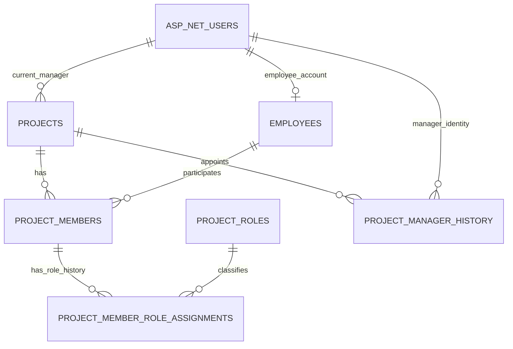

# TASK-02 – Phân tích khoảng trống nghiệp vụ và cơ sở dữ liệu

## Phạm vi và phương pháp

Phân tích này đối chiếu `TASK_FUNCTION_INVENTORY.md`, `TASK_02_DEEP_AUDIT.md`, đặc tả chính thức `TASK_02_BUSINESS_RULES.md` (QD-01 đến QD-15), tài liệu nghiệp vụ và source hiện tại. Các kết luận về TASK-02 dựa trên `Project`, `ProjectMember`, `Employee`, Identity, DbContext, migration, controller, service, viewmodel, view và các service khác đang tham chiếu những entity/thuộc tính này.

Schema được đọc ở chế độ SQLite chỉ đọc trên `Data/Databases/ConstructionProjectManagement.db`, có tính đến WAL đang tồn tại. Ngoài schema và migration metadata, chỉ đọc các nhãn vai trò không định danh: các giá trị phân nhóm `ProjectMembers.AssignmentRole` và tên `AspNetRoles`; không đọc thông tin cá nhân/từng user. Truy vấn nhóm `AssignmentRole` không trả hàng, nên hiện không có membership/role label nào để đối chiếu trong bảng đó; `AspNetRoles` có 8 role tên hệ thống được liệt kê ở Mục 1.2. Không khởi động ứng dụng, không chạy test/migration và không cập nhật Database. Vì vậy, báo cáo không kết luận về chất lượng dữ liệu cá nhân hay khả năng chạy end-to-end.

## 1. Tổng quan cấu trúc hiện tại

### 1.1 Công nghệ và tầng liên quan

- `ConstructionProjectManagement.csproj`: ASP.NET Core MVC trên .NET 10; EF Core SQLite và ASP.NET Core Identity phiên bản 10.0.1. Các file trong `Migrations.SqlServer/` bị loại khỏi compile.
- `Program.cs`: cấu hình Identity, SQLite và DI cho `IProjectService`/`ProjectService`, `IEmployeeService`/`EmployeeService`; khởi tạo ứng dụng gọi `DbInitializer.ApplyMigrationsAsync`.
- `Data/ApplicationDbContext.cs`: khai báo DbSet, quan hệ FK, delete behavior và index.
- `Migrations/20261111092125_InitialSqlite.cs`, `Migrations/ApplicationDbContextModelSnapshot.cs`: migration SQLite và snapshot được dùng trong source hiện tại.
- Tài liệu `docs/01_Business_Analysis/Business_02_Project_Management.md` cũ quy định mã dự án duy nhất trong dự án chưa lưu trữ; đặc tả mới `TASK_02_BUSINESS_RULES.md`, QD-15, thay bằng mã duy nhất toàn hệ thống kể cả dự án lưu trữ. Tài liệu nghiệp vụ cũ còn quy định ngày kết thúc không trước ngày bắt đầu, ngân sách không âm, chỉ tài khoản hoạt động được gán và không trùng thành viên trong một dự án.

### 1.2 Schema TASK-02 đang có

Database có 37 bảng, trong đó các bảng trực tiếp liên quan là:

| Bảng | Các cột liên quan | Ràng buộc/index quan sát được |
|---|---|---|
| `Projects` | `Id`, `ProjectCode`, `Name`, `StartDate`, `ExpectedEndDate`, `Budget`, `Status`, `ProjectManagerId`, `IsArchived` | PK `Id`; unique index toàn cục `ProjectCode`; FK `ProjectManagerId → AspNetUsers.Id`, `RESTRICT` |
| `ProjectMembers` | `Id`, `ProjectId`, `UserId`, `AssignmentRole`, `JoinedAt`, `IsActive` | PK `Id`; unique `(ProjectId, UserId)`; FK Project `CASCADE`, User `RESTRICT` |
| `Employees` | `Id`, `EmployeeCode`, `UserId`, `DepartmentId`, `Position`, `IsActive` | Unique `EmployeeCode` và `UserId`; FK User `RESTRICT`, Department `SET NULL` |
| `AspNetUsers` | Identity user, `FullName`, `IsActive` và các cột Identity | PK `Id`; được tham chiếu bởi Project, ProjectMember và Employee |

Schema live ghi nhận migration `20261111092125_InitialSqlite`, ProductVersion `10.0.1`. Không có bảng phân công vai trò theo thời gian, danh mục role theo project hoặc lịch sử PM; `ProjectMembers` cũng không có FK tới `Employees`. Schema không ràng buộc `ProjectManagerId` bắt buộc, phù hợp với QD-11 cho phép NULL.

`RoleNames.All` và `AspNetRoles` hiện có cùng 8 role xác thực: Admin, Project Director, Project Manager, Site Manager, Supervising Engineer, Worker, Materials Staff và Client Representative. Đây là role Identity; source không xác định chúng là danh mục phân công theo project. `Deputy Project Manager` được nêu trong QD-05 nhưng không nằm trong danh sách hiện tại. Do truy vấn `ProjectMembers.AssignmentRole` không trả hàng, không có giá trị role thành viên hiện tại để dùng làm nguồn bổ sung. QD-12 vì vậy chưa có đủ căn cứ để chốt danh sách role dự án; không tự thêm role còn thiếu hoặc nhập nguyên danh sách Identity vào catalog project.

### 1.3 Luồng hiện tại và giới hạn

```text
Browser
  -> ProjectsController / ProjectMembersController
  -> ProjectService / EmployeeService
  -> ApplicationDbContext
  -> Projects, ProjectMembers, Employees, AspNetUsers (SQLite)
  -> View / Redirect / thông báo TempData
```

- `ProjectsController.Create` chuyển PM và danh sách `MemberIds` đến `ProjectService.CreateAsync`. Service kiểm tra ngày, ngân sách, mã và tài khoản Identity hoạt động.
- `ProjectService.BuildMembers` chỉ tạo `ProjectMember` từ `memberIds`; `managerId` không được đưa vào danh sách này. Vì vậy PM có thể được gán vào `Project.ProjectManagerId` nhưng không tự trở thành thành viên hay nhận vai trò Project Manager.
- `ProjectService.UpdateAsync` xóa vật lý toàn bộ `existing.Members` rồi dựng lại từ `MemberIds`; vai trò và thời điểm tham gia của các bản ghi cũ không được giữ.
- `ProjectMembersController` cho phép các role Identity Admin, Project Director, Project Manager vào các action. `Index` nhận `projectId` nhưng không lọc theo PM chính; `EmployeeService.AddProjectMemberAsync` không nhận người đang thao tác để xác minh phạm vi QD-01.
- `EmployeeService.AddProjectMemberAsync` kiểm tra dự án chưa archive, tài khoản Identity hoạt động và membership trùng; không kiểm tra hồ sơ `Employee` hoặc `Employee.IsActive`.
- Các action POST tạo/sửa dự án và thêm nhân sự dùng `[ValidateAntiForgeryToken]`. Có validation ModelState và một số validation nghiệp vụ ở service; điều này không thay thế các kiểm tra vai trò, hồ sơ nhân sự và quy tắc assignment còn thiếu.

## 2. Bảng đối chiếu 15 quyết định

| Quyết định | Đánh giá | Bằng chứng hiện tại và khoảng trống |
|---|---|---|
| **QD-01 – Phạm vi quản lý thành viên** | **Chưa đáp ứng** | `ProjectMembersController` có `[Authorize(Roles = "Admin,Project Director,Project Manager")]`, nhưng `Index` chỉ tìm dự án theo ID, không kiểm tra người gọi là PM chính. `AddProjectMemberAsync` không nhận `currentUserId`; do đó code không phân biệt PM chính với PM chỉ là thành viên dự án. |
| **QD-02 – PM tự động thành thành viên** | **Một phần** | `Project.ProjectManagerId` lưu PM chính và `ProjectService.ValidateAsync` kiểm tra tài khoản đang hoạt động. Nhưng `CreateAsync` gọi `BuildMembers(memberIds, ...)`, không thêm `managerId`; `BuildMembers` cũng không gán `AssignmentRole`. Không có luồng đồng bộ khi thay PM. |
| **QD-03 – Ngừng tham gia, giữ lịch sử** | **Một phần** | `ProjectMember.IsActive` tồn tại, nhưng không có chức năng kết thúc/reactivate membership. `UpdateAsync` gọi `ProjectMembers.RemoveRange`, xóa vật lý bản ghi; unique `(ProjectId,UserId)` khiến thêm lại bản ghi đã tồn tại bị xem là trùng. |
| **QD-04 – PM chính và người hỗ trợ** | **Một phần** | `Project` chỉ có một `ProjectManagerId`, phù hợp lưu một PM hiện tại; không có lịch sử bổ nhiệm. Thành viên chỉ có một chuỗi `AssignmentRole`, không mô hình hóa nhiều vai trò hỗ trợ. Khi sửa dự án, danh sách membership bị thay toàn bộ; không có xử lý cụ thể cho PM cũ. |
| **QD-05 – Một nhân sự tham gia nhiều dự án theo vai trò** | **Chưa đáp ứng** | Không có kiểm tra số dự án đang hoạt động theo vai trò. `RoleNames` khai báo role Identity toàn hệ thống (ví dụ Project Manager, Site Manager, Supervising Engineer), không phải role theo từng ProjectMember. `Employee.Position` là một chuỗi vị trí nhân sự, không phải lịch sử vai trò theo dự án. |
| **QD-06 – Ưu tiên hồ sơ nhân sự, tạo mới qua TASK-07** | **Một phần** | `ProjectMembers` chỉ tham chiếu `AspNetUsers`; không có `EmployeeId`. `AddProjectMemberAsync` chỉ kiểm tra tài khoản active. `Employees.UserId` có unique index, nhưng `EmployeeService.SaveAsync` chỉ kiểm tra trùng `EmployeeCode`; dropdown `EmployeesController.LoadOptionsAsync` không loại user đã có Employee. Việc trùng UserId có thể chỉ bị chặn ở unique index khi lưu. Sau tạo hồ sơ, controller redirect về Employees Index, không quay lại project để tiếp tục thêm thành viên. |
| **QD-07 – Một nhân sự có nhiều vai trò trong dự án** | **Một phần** | Unique `(ProjectId,UserId)` ngăn lặp membership cho cùng cặp, nhưng `ProjectMember.AssignmentRole` chỉ chứa một vai trò dạng chuỗi. Không thể lưu nhiều vai trò song song mà không ghi đè hoặc tạo membership trùng. |
| **QD-08 – Lịch sử thay đổi vai trò** | **Chưa đáp ứng** | Không có bảng assignment role, ngày bắt đầu/kết thúc vai trò hay quy trình kết thúc role cũ và tạo role mới. `JoinedAt` là ngày tham gia membership, không đại diện đáng tin cậy cho ngày bắt đầu mỗi vai trò. |
| **QD-09 – Kết thúc một vai trò hoặc toàn bộ tham gia** | **Một phần** | Cột `IsActive` có sẵn nhưng không được tính từ role assignments; không có thao tác kết thúc một/nhiều vai trò. Khi sửa Project, membership có thể bị xóa vật lý thay vì chỉ inactive. |
| **QD-10 – Lịch sử PM chính độc lập** | **Chưa đáp ứng** | Chỉ có `Project.ProjectManagerId` hiện tại và FK tới Identity User. Không có bảng ghi người trước/người mới, ngày hiệu lực, ngày kết thúc hoặc lý do; cũng không có ràng buộc lịch sử chỉ có một kỳ PM đang mở. |
| **QD-11 – Project tạm thời không có PM** | **Một phần** | `Project.ProjectManagerId` nullable cả trong Model và schema, nên lưu được project chưa/không có PM. Chưa có quy trình đóng kỳ PM hiện tại khi bỏ PM, giữ lịch sử và để trạng thái không có kỳ active trước khi bổ nhiệm mới. |
| **QD-12 – Danh mục vai trò cố định** | **Chưa đáp ứng** | `ProjectMembers/Index.cshtml` nhận `AssignmentRole` từ ô nhập tự do; không có project-role catalog. `RoleNames.All`/`AspNetRoles` là 8 Identity roles, không phải danh mục phân công; `Deputy Project Manager` không có trong đó. Database hiện không có ProjectMember rows/AssignmentRole values để xác định danh mục lịch sử. |
| **QD-13 – Nhân sự nghỉ việc và khóa tài khoản** | **Chưa đáp ứng** | `Employee.IsActive` và `ApplicationUser.IsActive` là hai cờ riêng, nhưng `EmployeeService.SaveAsync` không kết thúc assignments khi nhân sự inactive; chưa có role assignment history. Khóa tài khoản trong `AccountController` không tự kết thúc membership (điểm này tránh đồng nhất hai trạng thái), nhưng quy trình nghỉ việc chưa có. Luồng thêm member chỉ kiểm tra `ApplicationUser.IsActive`, không kiểm tra `Employee.IsActive`; `SaveAsync` cũng bắt buộc user active ngay cả khi sửa Employee, tạo coupling giữa trạng thái đăng nhập và cập nhật hồ sơ. |
| **QD-14 – Phân công lại cùng vai trò** | **Chưa đáp ứng** | Không có bản ghi assignment có StartedAt/EndedAt; `AssignmentRole` là một chuỗi trên `ProjectMember`. Không thể giữ nhiều kỳ cùng role hoặc chặn hai kỳ active trùng theo Employee/Project/Role. |
| **QD-15 – ProjectCode duy nhất toàn hệ thống** | **Một phần** | Database có unique index toàn cục `ProjectCode`, phù hợp việc giữ mã sau archive. Nhưng `ProjectService.ValidateAsync` chỉ kiểm tra trùng khi `!IsArchived`; mã trùng project archived có thể vượt precheck rồi bị DB từ chối, không có lỗi nghiệp vụ sớm. Tài liệu `Business_02_Project_Management.md` cũ còn mâu thuẫn với QD-15 mới. |

## 3. Những thành phần đã đáp ứng

1. **Ràng buộc danh tính cơ bản:** `ProjectManagerId`, `ProjectMember.UserId` và `Employee.UserId` có FK tới `AspNetUsers`; xóa user bị hạn chế (`RESTRICT`).
2. **Không trùng membership hiện tại:** DbContext và schema live có unique `(ProjectId, UserId)`.
3. **Không trùng Employee theo mã/user ở tầng Database:** `EmployeeCode` và `UserId` đều có unique index. Service hiện chỉ kiểm tra trước mã nhân viên, nên chưa cung cấp thông báo thân thiện cho trường hợp trùng UserId.
4. **Cờ trạng thái và mốc đầu tiên:** `ProjectMember.IsActive` và `JoinedAt` đã có, nhưng chưa có lifecycle/historic workflow.
5. **Kiểm tra một phần tài khoản hợp lệ:** `ProjectService.ValidateAsync` và `EmployeeService.AddProjectMemberAsync` chỉ nhận Identity User đang active.
6. **Chống request forgery ở các POST được khảo sát:** `ProjectsController` và `ProjectMembersController.Add` có `[ValidateAntiForgeryToken]`.
7. **Tạo project và danh sách member hiện tại trong một lần lưu:** `ProjectService.CreateAsync` gắn `Project.Members` trước một lần `SaveChangesAsync`; EF Core transaction bảo vệ lần lưu đó. Tuy nhiên, PM chính không được tự đưa vào collection và chưa có các lịch sử/role record cần đồng bộ.
8. **Giữ Project ID cho quan hệ Task khác:** các bảng hợp đồng, tài liệu, WBS, task, tiến độ và nghiệp vụ khác tham chiếu Project qua `ProjectId`; giữ `Projects.Id` giúp tránh thay đổi khóa nền tảng.
9. **Có thể lưu Project chưa có PM:** `Project.ProjectManagerId` nullable và FK tương ứng cũng nullable, phù hợp phần cấu trúc của QD-11.
10. **Database đã giữ ProjectCode toàn cục duy nhất:** index hiện hành không lọc theo `IsArchived`, phù hợp QD-15; khoảng trống là precheck ở service chưa áp dụng cùng quy tắc.
11. **Tách trạng thái nhân sự và Identity ở Model:** `Employee.IsActive` và `ApplicationUser.IsActive` là hai thuộc tính khác nhau; source cũng có luồng khóa tài khoản riêng. Chưa có xử lý nghỉ việc đồng bộ với assignments.

## 4. Những thành phần cần sửa

| Mã | Thành phần và bằng chứng | Nguyên nhân / hậu quả | Hướng xử lý đề xuất |
|---|---|---|---|
| G-01 | `ProjectMembersController.Index` và `Add`; `EmployeeService.AddProjectMemberAsync` | Không kiểm tra `projectId` có thuộc PM đang gọi hay không; PM thành viên có thể truy cập luồng quản lý bất kỳ project nếu có role Identity phù hợp. | Đưa danh tính/actor vào service hoặc policy; kiểm tra Admin/Director hoặc PM chính (`Project.ProjectManagerId`) trên Server cho từng request. Giữ nguyên việc không cấp quyền chỉ vì là member. |
| G-02 | `ProjectService.CreateAsync`, `BuildMembers`, `UpdateAsync` | PM không tự được thêm thành viên/vai trò. Update xóa mọi member và dựng lại, làm mất `JoinedAt`, `AssignmentRole`, trạng thái và lịch sử. | Thay thao tác replace bằng đồng bộ có đối chiếu từng membership; không xóa cứng; ghi lịch sử role/PM trong cùng transaction. |
| G-03 | `ProjectMembersController`, `EmployeeService.AddProjectMemberAsync`, `EmployeesController.LoadOptionsAsync` | Chọn Identity User không bảo đảm có Employee profile hoặc Employee còn active. | Chọn hồ sơ Employee trước; kiểm tra Employee tồn tại/active và Identity User active ở Server. Sau khi tạo hồ sơ TASK-07, cung cấp đường quay lại đúng project/luồng thêm. |
| G-04 | `EmployeeService.SaveAsync`; index `Employees.UserId` | Không precheck UserId đã gắn với Employee khác; DB có thể từ chối unique constraint thay vì trả lỗi nghiệp vụ đã xử lý. | Thêm kiểm tra trùng UserId loại trừ chính Employee đang sửa, xử lý race/unique constraint theo chuẩn lỗi của ứng dụng. |
| G-05 | `ProjectMember.AssignmentRole`, view `Views/Projects/_ProjectForm.cshtml`, `Views/ProjectMembers/Index.cshtml` | Vai trò là chuỗi tự do một giá trị; form Project không quản lý role. Không thể chuẩn hóa, giới hạn theo role hoặc lưu history. | Chuyển role assignment thành entity có mã role, thời gian hiệu lực; giữ role nghiệp vụ riêng với Identity authorization role. |
| G-06 | `Project.ProjectManagerId`; `ProjectService.UpdateAsync` | Chỉ lưu người hiện tại, không có lịch sử khi đổi PM, cũng không đồng bộ membership/role của PM cũ và mới. | Lưu kỳ bổ nhiệm độc lập; đổi PM cập nhật Project, PM history, membership và assignment trong một giao dịch. |
| G-07 | `ProjectService.ValidateAsync`; `ApplicationDbContext`; `Business_02_Project_Management.md`; đặc tả QD-15 | QD-15 và DB yêu cầu giữ mã toàn cục, nhưng service lọc `!IsArchived`, nên một mã của project archived không bị báo trùng ở tầng nghiệp vụ rồi có thể phát sinh lỗi unique index khi lưu. Tài liệu Business 02 cũ lại nói chỉ unique trong project chưa lưu trữ. | Cập nhật precheck theo QD-15; giữ unique index toàn cục, không tạo filtered index. Cập nhật/đánh dấu tài liệu cũ để không còn mâu thuẫn. |
| G-08 | `EmployeeService.SaveAsync`; `EmployeesController`; `AccountController`; `Employee.IsActive`, `ApplicationUser.IsActive` | Có thể đổi trạng thái Employee riêng hoặc khóa account riêng, nhưng không có quy trình phân biệt nghỉ việc với khóa tạm thời và kết thúc mọi role assignment khi nghỉ việc. `SaveAsync` còn từ chối lưu Employee khi Identity user inactive, kể cả cập nhật hồ sơ; phân công member lại kiểm tra User active thay vì Employee active. | TASK-07 phải phát tín hiệu/luồng nghỉ việc riêng; trong cùng transaction kết thúc mọi assignment active và cập nhật membership. Account lockout chỉ đổi trạng thái đăng nhập, không kết thúc assignments; tách kiểm tra Employee eligibility khỏi trạng thái đăng nhập theo quyết định được xác nhận. |
| G-09 | `Views/ProjectMembers/Index.cshtml`; `Models/RoleNames.cs`; `AspNetRoles`; schema `ProjectMembers` | Role nhập tự do; Identity role không phải catalog assignment. QD-12 cấm catalog quản trị tùy ý, nhưng chưa có danh sách project-role chính thức và hiện không có AssignmentRole values để đối chiếu. `Deputy Project Manager` chưa có trong RoleNames. | Chốt danh sách và mã role chính thức trước khi seed/thiết kế ràng buộc; catalog chỉ được thay đổi qua thay đổi hệ thống có kiểm soát, không có CRUD role cho Admin. Không tự thêm Deputy hoặc các role mới. |

## 5. Những thành phần cần bổ sung

1. **Bảng phân công vai trò theo dự án** để ghi nhiều role đồng thời, khoảng thời gian, kết thúc role và giới hạn theo role.
2. **Bảng lịch sử PM chính** độc lập với assignment role, bảo đảm một PM hiện hành tối đa cho mỗi dự án và lưu các lần thay đổi.
3. **Liên kết membership với Employee** để đáp ứng QD-06, nhưng cần duy trì khả năng tương thích với các consumer hiện còn dùng `ProjectMember.UserId`.
4. **Danh mục project-role cố định** theo QD-12, nhưng chỉ sau khi người dùng xác nhận danh sách chuẩn. Không dùng `AspNetRoles`/`RoleNames` thay cho catalog assignment: đó là role xác thực/ủy quyền toàn hệ thống; không cho Admin CRUD danh mục role thông thường.
5. **Quy trình thay đổi trạng thái membership** dựa trên các role còn hiệu lực: kết thúc một role không được inactive membership nếu còn role khác; kết thúc role cuối mới inactive.
6. **Ràng buộc/service validation cho role bị giới hạn số project:** Site Manager và Supervising Engineer mặc định một project tại một thời điểm; PM và Deputy PM không bị giới hạn theo QD-05. Ngoại lệ phải chờ cơ chế phê duyệt giai đoạn sau.
7. **Kiểm soát concurrent update:** unique indexes/transaction phải bảo vệ việc cùng lúc phân công một người vào role giới hạn hoặc đổi PM, không chỉ dựa vào kiểm tra trước ở UI.
8. **Quy trình nghỉ việc TASK-07:** kết thúc mọi role assignment active, cập nhật membership khi không còn role, và không dùng việc khóa tài khoản thay thế cho quy trình nghỉ việc.

## 6. Thiết kế Database đề xuất

Đây là thiết kế phân tích, không phải migration đã thực hiện. Nên giữ nguyên `Projects.Id`, `Project.ProjectManagerId` và `ProjectMembers.Id` trong giai đoạn chuyển tiếp, rồi cập nhật consumer theo từng bước.

### 6.1 `ProjectMembers` – hồ sơ tham gia ổn định

| Cột đề xuất | Kiểu logic | Ràng buộc / mục đích |
|---|---|---|
| `Id` | INTEGER | PK; giữ ID hiện tại |
| `ProjectId` | INTEGER | FK `Projects(Id)`; không đổi project key |
| `EmployeeId` | INTEGER | FK `Employees(Id)`; thêm nullable trước khi backfill, sau đối soát có thể bắt buộc |
| `UserId` | TEXT | Giữ tạm làm liên kết tương thích với consumer hiện tại; đồng bộ với Employee.UserId |
| `JoinedAt` | DATETIME/TEXT | Ngày tham gia đầu tiên; không ghi đè khi re-activate |
| `IsActive` | BOOLEAN | Trạng thái tổng hợp; true khi còn ít nhất một role assignment active |

**Khóa/index:** PK `Id`; unique `(ProjectId, EmployeeId)` để không tạo membership lặp; nếu cần FK ghép, tạo alternate unique `(ProjectId, EmployeeId)`. Trong giai đoạn chuyển đổi, giữ unique `(ProjectId,UserId)` cho consumer cũ và tránh sinh membership thứ hai.

`AssignmentRole` không nên tiếp tục là nguồn dữ liệu chuẩn sau khi role assignment mới được đưa vào. Chưa xóa/đổi cột này trong migration đầu tiên; giữ làm legacy cho đến khi dữ liệu được đối soát và mọi consumer đã chuyển.

### 6.2 `ProjectRoles` – cấu trúc ứng viên cho danh mục role cố định

| Cột | Kiểu logic | Ràng buộc / mục đích |
|---|---|---|
| `Code` | TEXT/VARCHAR(50) | PK, mã ổn định; chỉ điền sau khi danh sách role dự án được duyệt |
| `DisplayName` | TEXT/NVARCHAR(100) | Tên hiển thị được kiểm soát ở cấp hệ thống |
| `ConcurrencyPolicy` | TEXT | Chính sách giới hạn được xác định từ QD-05 và role được duyệt |
| `MaxConcurrentProjects` | INTEGER NULL | NULL khi không có giới hạn số project; 1 cho Site Manager/Supervising Engineer theo mặc định QD-05 |

Đây chỉ là khung cấu trúc, không phải thiết kế database mục tiêu hay danh sách/seed role đã chốt. `RoleNames.All`/`AspNetRoles` hiện có 8 role Identity, `Deputy Project Manager` chưa có trong đó, và không có ProjectMember rows để lấy AssignmentRole hiện hành. Không tự chuyển 8 role Identity thành project role hoặc thêm role mới. Thiết kế schema cuối cùng và seed data cần nằm trong `TASK_02_TARGET_DATABASE_DESIGN.md` sau khi danh mục chính thức được xác nhận. Các hàng catalog chỉ được thay đổi qua migration/thay đổi hệ thống có kiểm soát; không cung cấp thao tác CRUD cho Admin. Cấu hình catalog không tự thay thế kiểm tra nghiệp vụ; việc gán cùng lúc phải được xác minh ở transaction/service. Với các role có giới hạn 1, có thể bổ sung unique filtered index riêng; ngoại lệ QD-05 cần được thiết kế cùng cơ chế phê duyệt ở giai đoạn sau.

### 6.3 `ProjectMemberRoleAssignments` – lịch sử role theo dự án

| Cột | Kiểu logic | Ràng buộc / mục đích |
|---|---|---|
| `Id` | INTEGER | PK |
| `ProjectId` | INTEGER | FK ghép cùng `EmployeeId` đến membership |
| `EmployeeId` | INTEGER | FK ghép cùng `ProjectId` đến `ProjectMembers` |
| `RoleCode` | TEXT/VARCHAR(50) | FK `ProjectRoles(Code)` |
| `StartedAt` | DATETIME/TEXT | Bắt buộc với assignment mới |
| `EndedAt` | DATETIME/TEXT NULL | NULL nếu role hiện hoạt; có thể check `EndedAt >= StartedAt` |

**Index:** unique filtered `(ProjectId, EmployeeId, RoleCode)` với `EndedAt IS NULL` để tránh ghi trùng cùng role đang hoạt động cho cùng member. Các index theo `(EmployeeId, RoleCode, EndedAt)` hỗ trợ kiểm tra số project đang active.

Mỗi lần đổi vai trò: đóng assignment cũ bằng `EndedAt`, thêm hàng mới; role khác vẫn có thể active cùng lúc. Khi không còn assignment active, cập nhật `ProjectMembers.IsActive=false`; khi thêm assignment lại, giữ membership và lịch sử cũ, đặt lại `IsActive=true`.

**Role giới hạn một project:** QD-05 yêu cầu Site Manager và Supervising Engineer mặc định chỉ thuộc một project tại một thời điểm. Có thể dùng filtered unique index riêng cho từng `RoleCode` đang active để bảo vệ race condition. QD-05 cũng nói ngoại lệ sẽ được phê duyệt ở giai đoạn sau; do chưa có cấu trúc phê duyệt nên chưa thể chốt cách cho phép ngoại lệ mà không làm suy yếu ràng buộc. Cần thiết kế lại index cùng cơ chế đó ở giai đoạn tương ứng.

### 6.4 `ProjectManagerHistory` – lịch sử PM chính độc lập

| Cột | Kiểu logic | Ràng buộc / mục đích |
|---|---|---|
| `Id` | INTEGER | PK |
| `ProjectId` | INTEGER | FK `Projects(Id)` |
| `PreviousManagerUserId` | TEXT NULL | FK `AspNetUsers(Id)`; người PM trước tại lần chuyển |
| `ManagerUserId` | TEXT | FK `AspNetUsers(Id)`; người giữ chức PM trong kỳ |
| `StartedAt` | DATETIME/TEXT NULL | Bắt buộc cho kỳ mới; NULL chỉ dùng khi backfill kỳ hiện tại không rõ ngày bắt đầu |
| `EndedAt` | DATETIME/TEXT NULL | NULL cho PM hiện hành |
| `Reason` | TEXT NULL | Lý do thay đổi nếu có |

**Index:** unique filtered trên `ProjectId` với `EndedAt IS NULL`, bảo đảm tối đa một kỳ PM đang mở mỗi project. `Project.ProjectManagerId` tiếp tục là giá trị current để các service hiện hữu không bị gãy; khi đổi PM, đóng kỳ cũ, thêm kỳ mới, cập nhật Project và đồng bộ membership/role trong cùng transaction.

Thiết kế trên giả định một hàng đại diện một kỳ nắm chức vụ PM. Theo QD-11, khi project tạm thời không có PM, đóng kỳ hiện tại, đặt `Project.ProjectManagerId=NULL` và không tạo PM thay thế giả; giai đoạn không có PM sẽ không có hàng history đang mở. Khi bổ nhiệm lại, thêm kỳ mới và lưu PM trước đó theo quy tắc đã xác nhận. Cần xác nhận `Reason` thuộc về kỳ bổ nhiệm mới hay việc kết thúc kỳ cũ.

### 6.5 Sơ đồ quan hệ đề xuất



`PROJECT_MEMBERS.UserId` là liên kết legacy có thể giữ tạm; đích đến là lấy User qua `Employee.UserId`, không tạo hai nguồn nhân sự độc lập.

## 7. Phân tích Migration và bảo toàn dữ liệu cũ

1. **Migration mới theo hướng cộng thêm:** không sửa migration `InitialSqlite` đã áp dụng; thêm migration SQLite mới sau khi thiết kế và mapping được xác nhận. DB live hiện ghi nhận `20261111092125_InitialSqlite` / EF `10.0.1`.
2. **Bảo toàn khóa và quan hệ hiện hữu:** không đổi `Project.Id`, `ProjectMember.Id`, `UserId` hoặc xóa bảng/cột trong bước đầu. `ProjectMembers.ProjectId` hiện cascade khi xóa Project; cần tiếp tục dùng archive thay vì hard-delete để tránh cascade làm mất lịch sử.
3. **Đối soát Employee trước khi bắt buộc `EmployeeId`:** truy vấn nhóm hiện tại cho thấy `ProjectMembers` không có hàng, nhưng phải kiểm tra lại trên đúng database triển khai trước migration. Nếu có membership, đối soát `UserId` với Employee và trạng thái active; lập danh sách ngoại lệ, không tự tạo Employee vì cần mã nhân viên và dữ liệu TASK-07.
4. **Không suy diễn lịch sử vai trò:** `AssignmentRole` là chuỗi nullable, `JoinedAt` là ngày tham gia membership. Truy vấn nhóm `AssignmentRole` hiện không trả hàng, nên không có role label membership nào trong Database để backfill; không có bằng chứng để xem `JoinedAt` là ngày bắt đầu vai trò hoặc diễn giải chuỗi legacy thành role canonical. Giữ cột cũ trong giai đoạn đầu; nếu phát hiện dữ liệu khác trên bản triển khai, lập mapping được nghiệp vụ duyệt trước khi chuyển.
5. **Không suy diễn lịch sử PM:** `ProjectManagerId` chỉ cho biết PM hiện tại. Không thể phục hồi PM trước, ngày bắt đầu hay lý do đổi. Có thể tạo baseline hiện tại với ngày bắt đầu chưa xác định (cho phép NULL riêng cho legacy); mọi thay đổi sau triển khai phải có ngày hiệu lực.
6. **Đồng bộ trong transaction:** cập nhật Project, PM history, membership và role assignment phải là một đơn vị giao dịch. Nếu luồng tạo Employee rồi thêm project member gồm nhiều `SaveChangesAsync`, cần transaction/recovery behavior được xác định để tránh trạng thái nửa chừng. `SaveChangesAsync` hiện tại của project create là một lần lưu; điều đó chưa bao phủ các bảng lịch sử chưa có.
7. **Index và provider:** schema đang chạy là SQLite; `Migrations.SqlServer/**/*.cs` bị loại compile. Filtered indexes, kiểu ngày và migration SQL Server (nếu còn là mục tiêu) cần kiểm tra riêng, không dùng một migration SQLite cho cả hai provider.
8. **Kiểm thử migration trước triển khai:** sao lưu DB; chạy migration trên bản sao; đối chiếu row count/ID/unique codes; kiểm tra FK bằng `PRAGMA foreign_key_check`, dữ liệu orphan, chỉ một PM active/project và không trùng role active; có phương án phục hồi. Các bước này chưa được chạy trong audit này.
9. **Mã dự án và archive:** QD-15 quy định mã unique toàn cục, gồm project archived. Index hiện tại đã đáp ứng và không nên chuyển thành filtered index. Sửa precheck service để cũng kiểm tra mọi project; đánh dấu tài liệu Business 02 cũ là mâu thuẫn cần cập nhật.
10. **Nghỉ việc và khóa tài khoản:** khi triển khai, chỉ luồng nghỉ việc thực sự mới đóng mọi role assignment; account lockout không được kích hoạt luồng đó. Trạng thái assignment phải còn nguyên khi chỉ khóa tài khoản.

## 8. Phân tích ảnh hưởng đến các Task khác

| Task/thành phần | Tham chiếu hiện có | Ảnh hưởng nếu đổi membership/PM |
|---|---|---|
| **TASK-01 – Identity** | `ApplicationUser`, `RoleNames`, Identity role checks, `ProjectManagerId`/`ProjectMember.UserId` FK; `AccountController` quản lý `ApplicationUser.IsActive`/lockout | Giữ trạng thái tài khoản độc lập với trạng thái nhân sự và role assignment. Khóa tài khoản tạm thời không được kích hoạt luồng chấm dứt assignment; không tái sử dụng Identity roles làm role assignment của project. |
| **TASK-03 – Hợp đồng/tài liệu** | `ContractService`, `ProjectDocumentService` dùng Project, `ProjectManagerId` và/hoặc `ProjectMembers.UserId`/`IsActive` cho phạm vi truy cập | Nếu chuyển từ UserId sang EmployeeId, cập nhật truy vấn visibility qua `Employee.UserId`; giữ Project ID/PM hiện tại hoặc duy trì tương thích. |
| **TASK-04 – Giai đoạn/WBS** | `WbsService` dùng project và membership để xác định phạm vi | Không được thay semantics `IsActive` đột ngột; khi kết thúc mọi role phải đảm bảo WBS visibility phản ánh trạng thái membership mới. |
| **TASK-05 – Quản lý công việc** | `TaskService` cho phép PM hoặc member active; `TaskAssignment` gắn trực tiếp với Identity User | Đồng bộ membership active với assignment eligibility. Nếu Employee inactive nhưng Identity active, code hiện chưa xem Employee status; cần định nghĩa khi chuyển sang Employee-based rule. |
| **TASK-06 – Tiến độ** | `ProgressService` dùng project, PM và membership để truy cập/cập nhật dữ liệu | Cần cập nhật các truy vấn UserId/IsActive cùng lúc, nếu không người đã hết role có thể vẫn được xem hoặc bị loại sai. |
| **TASK-07 – Nhân sự/đội thi công** | `EmployeeService`, `EmployeesController`, `TeamMember.EmployeeId`, `Employee.IsActive` | Đây là nguồn hồ sơ Employee và điểm tích hợp chính cho QD-06/QD-13. Tạo luồng nghỉ việc riêng để đóng mọi assignment active nhưng giữ lịch sử; không đồng nhất với Identity lockout. `AddProjectMemberAsync` hiện kiểm tra `ApplicationUser.IsActive`, không kiểm tra `Employee.IsActive`; `EmployeeService.SaveAsync` cũng không cho cập nhật hồ sơ khi user inactive. |
| **Dashboard** | `DashboardService` dùng PM và membership active | Cập nhật query/aggregation khi đổi membership FK; giữ trạng thái active tương thích. |
| **TASK-08 trở đi – vật tư, thiết bị, nhật ký, chất lượng, chi phí/bàn giao** | Các entity liên quan có FK trực tiếp đến `ProjectId`; khảo sát usage không thấy dùng `ProjectMember.AssignmentRole` làm schema phụ thuộc trực tiếp | Giữ `Projects.Id` và archive semantics. Các màn hình/lọc theo người thực hiện có thể cần rà lại nếu sau này thay quy tắc Employee/User, nhưng không có căn cứ để đề xuất sửa rộng ở bước này. |

Các consumer cụ thể của `ProjectManagerId`, `ProjectMember.UserId` và `IsActive` được tìm thấy trong `ProjectService`, `ContractService`, `ProjectDocumentService`, `WbsService`, `TaskService`, `ProgressService` và `DashboardService`. `AssignmentRole` được dùng ở luồng ProjectMembers/Employee và hiển thị chi tiết Project; cần cập nhật chúng khi chuyển sang assignment table. `Employee.IsActive` được dùng ở lựa chọn nhân sự cho Teams, nhưng không thấy luồng nào tự đóng project membership/assignment khi nhân sự nghỉ việc.

## 9. Vấn đề khác có bằng chứng

1. **Mã dự án sau archive: DB đúng, precheck service và tài liệu cũ không đúng với QD-15:** `ApplicationDbContext` và schema live có unique index toàn cục `IX_Projects_ProjectCode` (`PARTIAL=0`), phù hợp QD-15. Tuy nhiên `ProjectService.ValidateAsync` lọc `!IsArchived`, nên mã của project archived không bị báo trùng ở tầng nghiệp vụ rồi có thể bị DB từ chối khi lưu. `Business_02_Project_Management.md` cũ còn quy định chỉ unique trong dữ liệu chưa lưu trữ; đặc tả QD-15 mới đã chốt không tái sử dụng mã.
2. **Cập nhật Project phá lịch sử membership:** `ProjectService.UpdateAsync` gọi `RemoveRange(existing.Members)` và dựng lại hàng từ `MemberIds`; `_ProjectForm.cshtml` chỉ gửi danh sách UserId, không gửi `JoinedAt`, role hoặc trạng thái. Đây là hành vi code hiện tại, không chỉ nguy cơ lý thuyết.
3. **PM có thể không xuất hiện trong danh sách thành viên:** PM được cộng vào tập user validation trong `ValidateAsync`, nhưng `BuildMembers` chỉ nhận `memberIds`; PM chọn riêng ở form. Vì vậy tạo PM không đồng nghĩa tạo membership.
4. **Danh sách PM/nhân sự chưa dựa trên Employee:** `ProjectsController.LoadUsersAsync`, `ProjectMembersController.Index` và `EmployeesController.LoadOptionsAsync` nạp Identity User active. Không loại User đã có/không có Employee theo đúng từng luồng.
5. **Role catalog chưa thể chốt từ dữ liệu hiện tại:** `RoleNames.All`/`AspNetRoles` có 8 role Identity; `Deputy Project Manager` trong QD-05 không có trong danh sách đó. ProjectMembers hiện rỗng nên không có `AssignmentRole` đã lưu để đối chiếu. Không có căn cứ dùng các Identity role làm danh mục project-role hoặc tự bổ sung role.
6. **Chưa có quy trình nghỉ việc:** `AccountController` thay đổi trạng thái đăng nhập/lockout độc lập; `EmployeeService.SaveAsync` có thể cập nhật `Employee.IsActive`, nhưng không kết thúc assignments. Đây là phần còn thiếu của QD-13, dù trạng thái Identity và Employee hiện đã tách thuộc tính.
7. **Chưa có bằng chứng runtime:** không chạy app, test, migration hoặc ghi Database theo phạm vi đã định. Các đánh giá là source/schema review và kiểm tra một số nhãn vai trò; không xác nhận giao dịch concurrent, thông báo runtime hoặc dữ liệu cá nhân.

## 10. Các vấn đề còn cần xác nhận

1. **Danh mục project-role cố định:** cần danh sách tên/mã chính thức để so với 8 Identity roles hiện có và nghiệp vụ QD-05/QD-12. Đặc biệt, xác nhận `Deputy Project Manager` có thuộc danh mục project-role không; không tự thêm vào `RoleNames` hoặc catalog.
2. **Tách khái niệm role:** xác nhận tên role phân công theo project độc lập với `Employee.Position` và Identity roles. Code hiện chỉ chứng minh các Identity role; Database hiện không có `ProjectMembers`/AssignmentRole rows làm nguồn bổ sung.
3. **Tài khoản bị khóa tạm thời:** QD-13 đã quy định không kết thúc assignments, nhưng chưa nói rõ Employee vẫn active và Identity user bị khóa có được nhận phân công mới hay không. Cần tách kiểm tra đăng nhập khỏi kiểm tra Employee eligibility.
4. **Luồng nghỉ việc TASK-07:** cần xác định điểm nghiệp vụ phát tín hiệu nghỉ việc và cách xử lý atomically trên tất cả project assignments; tài khoản Identity có bị khóa đồng thời hay không, nhưng không được dùng lockout làm tín hiệu nghỉ việc.
5. **Lịch sử khoảng thời gian membership:** QD-03 yêu cầu bảo toàn lịch sử, QD-08/14 lưu lịch sử từng role. Cần xác nhận lịch sử role có đủ để thể hiện các giai đoạn member tham gia/rời dự án hay cần lưu riêng các kỳ membership.
6. **Chồng lấn và hiệu lực vai trò:** QD-08 cho phép nhiều role đồng thời nếu nghiệp vụ cho phép; cần quy tắc về các cặp role được phép đồng thời, hiệu lực ngày/giờ và thời điểm kết thúc role cũ.
7. Khi chưa có hồ sơ Employee, TASK-07 chỉ tạo hồ sơ cho Identity User đã tồn tại hay cũng phải tạo tài khoản Identity? Cần xác định điều hướng và rollback nếu tạo Employee thành công nhưng thêm vào project thất bại.
8. **Ngoại lệ giới hạn dự án của QD-05:** quy trình phê duyệt được chủ động để giai đoạn sau; thiết kế index/constraint cuối cùng phải tương thích với cơ chế đó, không tự xây trong TASK-02.
9. **PM history:** QD-11 đã xác nhận cho phép giai đoạn không có PM. Cần chốt `Reason` thuộc về lần bổ nhiệm mới hay việc kết thúc PM cũ, và có lưu người thực hiện thay đổi không.
10. **Tài liệu ProjectCode cũ:** QD-15 đã chốt mã unique toàn cục; `Business_02_Project_Management.md` nói khác. Cần cập nhật hoặc đánh dấu tài liệu cũ để tránh người triển khai hiểu nhầm.
11. **Provider Database:** `docs/03_Database/Database_Design.md` mô tả SQL Server, trong khi csproj/runtime/migration live hiện dùng SQLite và loại migration SQL Server khỏi compile. Cần xác nhận SQL Server còn là provider mục tiêu không.
12. **PM hỗ trợ:** QD-04 cho phép nhiều người quản lý hỗ trợ nhưng chưa liệt kê các role hỗ trợ chuẩn; cần gắn vào danh mục QD-12 sau khi xác nhận.

## 11. Kế hoạch triển khai đề xuất theo thứ tự

Đây là thứ tự đề xuất, chưa thực hiện:

1. **Chốt các điểm mở tại Mục 10:** danh mục project-role, phân biệt Identity lock và Employee eligibility, luồng nghỉ việc, role overlap, kỳ membership, PM-history reason và provider Database. QD-11 cho phép không có PM, QD-14 yêu cầu tạo kỳ role mới khi phân công lại, QD-15 yêu cầu ProjectCode unique toàn cục.
2. **Thiết kế hợp đồng dữ liệu đích:** thống nhất ProjectMember↔Employee, mã role, assignment dates, PM history và trạng thái active; lập ma trận consumer tại Mục 8.
3. **Kiểm kê dữ liệu thật trước migration:** audit hiện tại không thấy ProjectMembers rows, nhưng phải kiểm tra lại trên đúng database triển khai trước migration. Đối soát ProjectMember ↔ Employee, AssignmentRole legacy, PM hiện tại, code trùng và project archive; không tự gán mốc thời gian/role lịch sử.
4. **Migration cộng thêm:** sau khi danh mục role được chốt, tạo catalog hệ thống không có CRUD role thông thường, assignment history và PM history; thêm EmployeeId theo giai đoạn; giữ cột/ID cũ, tạo indexes/FKs và kiểm tra trên bản sao DB.
5. **Cập nhật TASK-07 và luồng membership:** chọn Employee, ngăn duplicate Employee/User, hỗ trợ quay lại project context, add/reactivate và end participation.
6. **Cập nhật PM/membership transaction:** cho phép project không có PM; khi bổ nhiệm/đổi PM, tự tạo membership và role Project Manager theo danh mục đã duyệt; cập nhật history, đóng kỳ trước và giữ PM cũ nếu còn role. Một giao dịch bảo vệ toàn bộ.
7. **Cập nhật consumer TASK-03/04/05/06/Dashboard:** truy vấn quyền/phạm vi qua membership mới; giữ tương thích Project ID và `ProjectManagerId`.
8. **Gỡ legacy chỉ sau đối soát:** bỏ `AssignmentRole`/`UserId` cũ khi mọi consumer và dữ liệu đã chuyển, có phương án rollback và backup.
9. **Kiểm thử nghiệm thu:** unit/integration, migration upgrade trên bản sao SQLite, concurrency, unauthorized PM, history, FK/index, dữ liệu cũ và các Task phụ thuộc. Chỉ triển khai sau khi test đạt.

## 12. Tiêu chí nghiệm thu Database và Function

### Database

- Mỗi ProjectMember được liên kết duy nhất với một Employee; unique `(ProjectId, EmployeeId)` không cho membership trùng.
- Tạo được nhiều role assignment cho một nhân sự trong cùng project; mỗi role có thời gian bắt đầu/kết thúc, không ghi đè assignment lịch sử.
- Có thể có 0 hoặc 1 PM chính active trên một project; khi có PM, `Projects.ProjectManagerId` khớp với kỳ PM đang mở; khi không có PM, trường này NULL và không có kỳ PM active.
- Site Manager và Supervising Engineer mặc định không có assignment active ở nhiều project; ngoại lệ chỉ hoạt động theo cơ chế được phê duyệt sau.
- FK không có orphan; xóa user/project không làm mất lịch sử hợp lệ; project archive không hard-delete membership/history.
- Migration giữ nguyên IDs, project/member records, không suy diễn lịch sử thiếu; kiểm chứng được row count và dữ liệu trước/sau trên bản sao.
- ProjectCode giữ unique toàn cục trong DB, kể cả project archived; precheck service áp dụng cùng quy tắc và không cho tái sử dụng code.
- Danh mục project-role là hệ thống định nghĩa, không có thao tác Admin thêm/sửa/xóa; giá trị seed khớp danh sách được xác nhận.
- Employee nghỉ việc kết thúc tất cả assignment active và giữ history; chỉ lock tài khoản không kết thúc assignment.

### Function theo QD

| QD | Tiêu chí nghiệm thu tối thiểu |
|---|---|
| QD-01 | Admin/Director quản lý mọi project; PM chính chỉ quản lý project có `ProjectManagerId` trùng mình; PM chỉ là member bị từ chối ở cả GET lẫn POST. |
| QD-02 | Tạo/bổ nhiệm PM ghi PM vào Project, tạo hoặc tái kích hoạt membership và role PM; không có duplicate; các thay đổi atomic. |
| QD-03 | Kết thúc tham gia đặt inactive, giữ hàng/lịch sử; thêm lại dùng lại membership theo quy tắc đã chốt, không xóa vật lý. |
| QD-04 | Có tối đa một PM chính hiện hành; PM hỗ trợ có thể tồn tại đồng thời; PM cũ giữ role nếu còn nhiệm vụ; lịch sử không bị xóa khi cập nhật Project. |
| QD-05 | PM/Deputy PM được tham gia nhiều project; Site Manager/Supervising Engineer mặc định một project; kiểm tra được concurrent update; ngoại lệ chỉ theo quyết định/phê duyệt tương ứng. |
| QD-06 | Chọn Employee có sẵn trước; ngăn chọn hồ sơ inactive/trùng; tạo mới qua TASK-07 và quay lại đúng project; lỗi khi thêm member không làm mất dữ liệu đã tạo. |
| QD-07 | Một membership có thể có nhiều role active song song nhưng không tạo duplicate Employee hoặc ProjectMember. |
| QD-08 | Đổi role đóng đúng kỳ cũ, thêm kỳ mới với thời gian; role khác vẫn active; không overwrite lịch sử. |
| QD-09 | Kết thúc một role không inactive member nếu còn role active; kết thúc role cuối cùng mới inactive membership. |
| QD-10 | Mỗi thay đổi PM lưu PM trước/mới, kỳ hiệu lực và reason nếu có; lịch sử PM độc lập với role assignment; chỉ một PM active/project. |
| QD-11 | Project có thể không có PM (`ProjectManagerId=NULL`); không tự chọn PM thay thế; lịch sử kỳ trước được giữ và lần bổ nhiệm sau tạo kỳ history mới. |
| QD-12 | Form chỉ cho chọn role từ danh mục cố định đã duyệt; Admin không thể CRUD danh mục qua giao diện thông thường; thay đổi catalog qua quy trình hệ thống có kiểm soát. |
| QD-13 | Nghỉ việc thật kết thúc mọi assignment active và chặn assignment mới; khóa tài khoản tạm thời không đổi Employee/ProjectMember/assignment history. |
| QD-14 | Phân công lại cùng role tạo kỳ mới; các kỳ cũ được giữ nguyên; unique filtered constraint chỉ cấm hai kỳ đang hiệu lực trùng Employee/Project/Role. |
| QD-15 | Precheck nghiệp vụ và unique index DB cùng cấm ProjectCode đã dùng, kể cả project archived; archive không giải phóng mã. |

## Kết luận

Schema hiện tại cung cấp nền tảng Project, Identity User, Employee và membership đơn giản, nhưng chủ yếu mô hình hóa **một user – một membership – một chuỗi role hiện tại**. Nó chưa đáp ứng lịch sử nhiều role, danh mục project-role cố định, quy tắc nhân sự theo Employee, lịch sử PM và lifecycle không xóa vật lý theo QD-01 đến QD-14. Với QD-15, unique index toàn cục hiện đã đúng nhưng precheck service và tài liệu nghiệp vụ cũ chưa đồng nhất. Cần hoàn thiện các điểm còn mở, sau đó thiết kế/migrate theo hướng bổ sung, giữ nguyên khóa và cập nhật các service phụ thuộc theo từng giai đoạn. Không có thay đổi source code hay Database được thực hiện trong báo cáo này.
