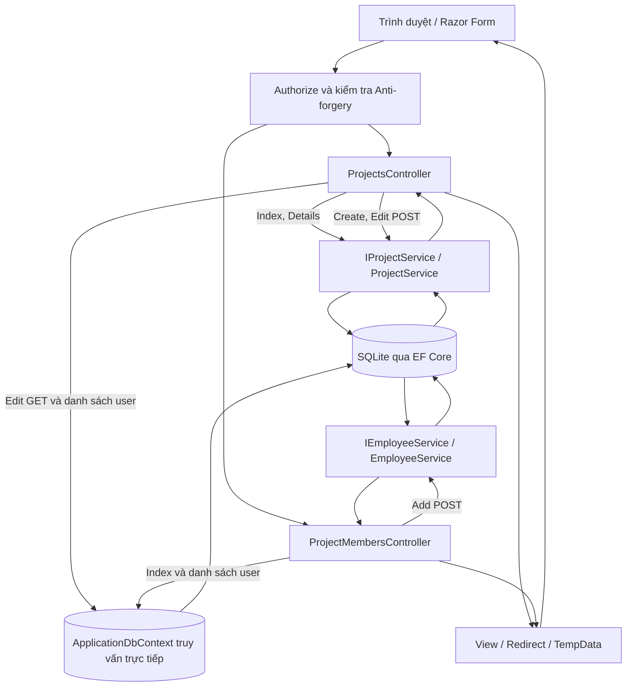

# TASK-02 — Audit chuyên sâu: Quản lý dự án và thành viên dự án

> **Phạm vi:** Phân tích tĩnh source hiện tại cho FN-02-01 đến FN-02-06. Không sửa source, không chạy ứng dụng, không thao tác cơ sở dữ liệu hoặc migration. Đường dẫn trong báo cáo tính từ thư mục gốc project.

## 1. Tổng quan hiện trạng

### Kiến trúc và thành phần

- Ứng dụng là ASP.NET Core MVC trên .NET 10, EF Core 10.0.1, ASP.NET Core Identity và SQLite theo `Program.cs` (`UseSqlite`, đăng ký Identity, middleware authentication/authorization và MVC route mặc định).
- `ProjectsController` xử lý danh sách, chi tiết, tạo và sửa dự án. `ProjectService` thực hiện truy vấn, validation nghiệp vụ và ghi `Project` cùng các `ProjectMember` ban đầu.
- `ProjectMembersController` hiển thị danh sách thành viên và nhận form thêm thành viên. Trang danh sách đọc trực tiếp `ApplicationDbContext`; thao tác thêm gọi `IEmployeeService.AddProjectMemberAsync`.
- `Project` tham chiếu tùy chọn tới `ApplicationUser` làm Project Manager và có tập `ProjectMember`. `ProjectMember` nối `Project` với `ApplicationUser`, có `AssignmentRole`, `JoinedAt`, `IsActive`.
- Không có Repository layer. `IProjectService`/`ProjectService` và `IEmployeeService`/`EmployeeService` được đăng ký scoped trong `Program.cs`.

### Quy tắc nghiệp vụ được ghi nhận

`docs/01_Business_Analysis/Business_02_Project_Management.md` quy định: mã dự án duy nhất trong dữ liệu chưa lưu trữ; ngày kết thúc không trước ngày bắt đầu; ngân sách không âm; chỉ tài khoản đang hoạt động được gán làm Project Manager/thành viên; người không phải Admin/Project Director chỉ xem dự án do mình quản lý hoặc tham gia; thành viên không trùng trong cùng dự án; dự án lưu trữ mềm.

### Kết luận chính

Luồng MVC và persistence cho cả sáu Function đều hiện diện. Tuy nhiên, có lỗi có thể tái hiện từ logic source ở việc dùng lại mã dự án sau khi archive, cập nhật thành viên làm mất metadata, và truy cập/quản lý thành viên không giới hạn theo project. Vì chưa có kiểm thử E2E cho các Function này, không Function nào được xếp `COMPLETE`.

Ma trận kiểm thử ghi quy trình khởi tạo dự án ở trạng thái `READY_FOR_USER_TEST`; những kiểm tra route unauthenticated (302 về Login) không chứng minh luồng nghiệp vụ hoạt động. Không tìm thấy project hoặc file test C# trong source. Không chạy ứng dụng vì `Program.cs` gọi `DbInitializer.ApplyMigrationsAsync` lúc khởi động, có thể áp dụng migration vào SQLite.

## 2. Sơ đồ luồng xử lý

`ValidateAntiForgeryToken` có trên các POST của cả hai Controller; các form dùng ASP.NET Core Form Tag Helper. Luồng dự án không hoàn toàn đi qua Service: `ProjectsController.Edit(GET)` và `ProjectMembersController.Index` đọc DbContext trực tiếp.

## 3. Phân tích chi tiết 6 Function

### FN-02-01 — Xem danh sách dự án

**Trạng thái: NEEDS_DECISION**

- **Luồng:** GET `ProjectsController.Index(CancellationToken)` lấy tài khoản hiện hành bằng `UserManager`; nếu không có thì `Challenge()`. Sau đó gọi `IProjectService.GetVisibleProjectsAsync(userId, isAdminOrDirector, token)` và trả `ProjectListViewModel` cho `Views/Projects/Index.cshtml`.
- **Truy vấn/đầu ra:** `ProjectService.GetVisibleProjectsAsync` lấy các dự án chưa archive, `AsNoTracking`, Include Project Manager và `Members.User`; sắp xếp `CreatedAt` giảm dần. Admin/Project Director thấy mọi dự án chưa archive; các role khác chỉ thấy dự án có họ là Project Manager hoặc thành viên `IsActive`.
- **Giao diện:** Bảng hiển thị mã, tên, Project Manager, thời gian, trạng thái; có liên kết Chi tiết và, với Admin/Director, Sửa. Nút Tạo dự án cũng chỉ hiện với hai role này.
- **Validation/lỗi:** `[Authorize]` trên Controller yêu cầu đăng nhập. Tài khoản không lấy được trả `Challenge`; service không ném lỗi nghiệp vụ cho danh sách rỗng. Không có filter/search/page, empty-state riêng, hoặc kiểm tra page size vì không có phân trang.
- **Đánh giá:** Quy tắc visibility trong service phù hợp phần lớn với Business 02; truy vấn lọc ở DB thay vì lọc sau khi tải. Chưa có bằng chứng test theo tài khoản/role. Danh sách tải toàn bộ dự án và toàn bộ thành viên/User được Include; Business 02 không xác định nhu cầu phân trang hay quy mô dự kiến. Cần xác nhận tiêu chí vận hành trước khi gọi là hoàn tất.
- **Bằng chứng:** `Controllers/ProjectsController.cs::Index`; `Services/ProjectService.cs::GetVisibleProjectsAsync`; `ViewModels/ProjectViewModels.cs::ProjectListViewModel`; `Views/Projects/Index.cshtml`.

### FN-02-02 — Xem chi tiết dự án

**Trạng thái: NEEDS_DECISION**

- **Luồng:** GET `ProjectsController.Details(id, token)` lấy user và gọi `ProjectService.GetByIdAsync(id, userId, isAdminOrDirector, token)`. Trả `NotFound` khi project không tồn tại, đã archive hoặc nằm ngoài phạm vi visibility; nếu có thì trả `Views/Projects/Details.cshtml`.
- **Dữ liệu tải:** Service Include Project Manager và `Members.User`. View hiển thị các thuộc tính dự án, tên/user name và `AssignmentRole` của tất cả hàng `Members`; có liên kết WBS và trang thành viên.
- **Validation/quan hệ:** ID không tìm thấy hoặc không được phép xem đều thành `NotFound`, tránh trả chi tiết cho user ngoài phạm vi. FK Project Manager/member được ánh xạ trong DbContext.
- **Điểm cần xác nhận:** Service không lọc `ProjectMember.IsActive`; Details hiển thị cả hàng thành viên inactive. Chưa rõ nghiệp vụ muốn hiển thị danh sách hiện tại hay cả thành viên lịch sử. View tải đủ quan hệ đang hiển thị (Project Manager, Members, User), nhưng không tải Phases/Tasks/Contracts; hiện tại các phần đó không được hiển thị trong Details, nên chưa có căn cứ coi đây là thiếu.
- **Khả năng kiểm chứng:** Chưa có test thành viên/Project Manager/Admin/Director, truy cập project archive, hoặc người ngoài project. Ma trận hiện chỉ chứng minh các route yêu cầu đăng nhập.
- **Bằng chứng:** `Controllers/ProjectsController.cs::Details`; `Services/ProjectService.cs::GetByIdAsync`; `Views/Projects/Details.cshtml`.

### FN-02-03 — Tạo dự án

**Trạng thái: BUG**

- **Luồng:** GET Create được giới hạn Admin/Project Director, nạp danh sách tài khoản đang hoạt động và dựng form. POST Create có cùng ràng buộc role, `ValidateAntiForgeryToken`, kiểm tra `ModelState`, lấy người tạo rồi gọi `ProjectService.CreateAsync`. Thành công đặt TempData và redirect Details; lỗi nghiệp vụ thêm ModelState error, nạp lại user và render form.
- **Đầu vào:** `ProjectEditViewModel`: ProjectCode, Name, Location, ClientName, StartDate, ExpectedEndDate, Budget, Status, ProjectManagerId, MemberIds. `ToEntity` ánh xạ các trường project; Service gán manager, timestamps, trim mã/tên và dựng member với `JoinedAt=UtcNow`, `IsActive=true`.
- **Validation:** ViewModel có Required/độ dài cho mã và tên, độ dài Location/ClientName, Range ngân sách không âm; Service kiểm tra ngày kết thúc, ngân sách, mã trùng và mọi manager/member được chọn phải là user đang hoạt động. Danh sách ID được Distinct trước khi kiểm tra/tạo; FK và unique index là lớp DB bổ sung.
- **Dữ liệu ban đầu:** Project cùng các Member được thêm trong một `SaveChangesAsync`; EF Core thực hiện lưu một lần, không có đoạn lưu project riêng trước member. Không thấy Service tự đưa Project Manager vào danh sách Members; model hiện lưu hai khái niệm riêng. Business 02 chưa nói manager có mặc định là thành viên hay không.
- **Lỗi xác định — mã đã dùng ở dự án archive:** Business 02 cho phép mã duy nhất trong các dự án chưa lưu trữ. `ProjectService.ValidateAsync` cũng chỉ dò mã trùng ở project chưa archive. Nhưng `ApplicationDbContext` và migration SQLite tạo unique index toàn cục trên `Projects.ProjectCode`, không điều kiện theo `IsArchived`. Nếu mã cũ thuộc project archive, validation cho qua nhưng insert bị unique constraint; Service/Controller không bắt lỗi DB để trả thông báo nghiệp vụ. Kết quả là request có thể lỗi thay vì tạo project theo quy tắc tài liệu.
- **Quy tắc chưa được đặc tả:** Form cho chọn mọi giá trị `ProjectStatus` đã khai báo; Service không kiểm tra chuyển trạng thái từ giá trị cũ sang mới. Business 02 chỉ nói quản lý trạng thái, không quy định lifecycle/role cho từng chuyển đổi. Việc Project Manager có bắt buộc hay có thể để null cũng chưa được quy định rõ (field nullable, không có Required).
- **Khả năng kiểm chứng:** Không chạy submission thực tế; không có bằng chứng E2E cho thành công, lỗi validation, rollback hoặc xử lý unique constraint.
- **Bằng chứng:** `Controllers/ProjectsController.cs::Create`, `ToEntity`, `LoadUsersAsync`; `Services/ProjectService.cs::CreateAsync`, `ValidateAsync`, `BuildMembers`; `ViewModels/ProjectViewModels.cs::ProjectEditViewModel`; `Data/ApplicationDbContext.cs` (unique index); `Migrations/20261111092125_InitialSqlite.cs` (unique index).

### FN-02-04 — Cập nhật dự án

**Trạng thái: BUG**

- **Luồng:** GET Edit chỉ cho Admin/Project Director; nạp project chưa archive bằng `AsNoTracking` và Include Members, ánh xạ dữ liệu vào `ProjectEditViewModel`, nạp active users. POST có role guard, anti-forgery, đối chiếu route `id` với `model.Id`, kiểm tra ModelState rồi gọi `ProjectService.UpdateAsync`; thành công redirect Details, lỗi nghiệp vụ trả form.
- **Dữ liệu/validation:** Service nạp project đang tracked, kiểm tra tồn tại và chưa archive; áp dụng cùng các rule mã/ngày/ngân sách/user hoạt động của Create. Cập nhật các trường scalar, manager, `UpdatedAt`.
- **Lỗi xác định — ghi đè lịch sử thành viên:** Sau khi validation thành công, `UpdateAsync` gọi `ProjectMembers.RemoveRange(existing.Members)` rồi gán toàn bộ collection mới từ `BuildMembers(memberIds, ...)`. Mọi `ProjectMember` cũ bị xóa vật lý và tạo lại, kể cả người không đổi. `BuildMembers` chỉ gán UserId, JoinedAt mới và IsActive=true; không giữ `Id`, `AssignmentRole`, `JoinedAt`, hay IsActive cũ. Form `_ProjectForm.cshtml` chỉ cho chọn MemberIds, không có AssignmentRole. Sửa bất kỳ trường project nào cũng có thể làm mất vai trò/thời điểm tham gia, đổi hàng inactive thành active nếu ID còn được gửi, hoặc xóa hàng không có trong form.
- **Xử lý atomicity:** Thay đổi project và thành viên được flush bằng một `SaveChangesAsync`, nên EF Core thường lưu trong transaction nội bộ; tuy nhiên điều này không bảo toàn semantics của các hàng bị thay thế. Không có test chứng minh update với danh sách giữ nguyên, rỗng, có member cũ/inactive, hoặc thay đổi đồng thời.
- **Điểm cần quyết định:** Khi bỏ một thành viên, nghiệp vụ muốn xóa vật lý hay đặt `IsActive=false`? Có cần giữ lịch sử AssignmentRole/JoinedAt? Member inactive có được tự động phục hồi khi sửa dự án không?
- **Bằng chứng:** `Controllers/ProjectsController.cs::Edit`; `Services/ProjectService.cs::UpdateAsync`, `BuildMembers`; `Views/Projects/_ProjectForm.cshtml`; `Models/ProjectMember.cs`.

### FN-02-05 — Xem thành viên dự án

**Trạng thái: BUG**

- **Luồng:** `ProjectMembersController.Index(projectId, token)` đọc Project trực tiếp từ DbContext, Include Members.User, loại project archive; không thấy thì `NotFound`. ViewBag.Project chứa dữ liệu dự án; ViewBag.Users gồm tài khoản đang hoạt động mà ID chưa xuất hiện trong bất kỳ ProjectMember nào; `Views/ProjectMembers/Index.cshtml` hiển thị danh sách cùng AssignmentRole.
- **Lỗi xác định — thiếu kiểm tra phạm vi project:** Controller chỉ có `[Authorize(Roles = "Admin,Project Director,Project Manager")]`; `Index` không lấy user hiện hành và không kiểm tra họ là Project Manager của project hay member active. Do đó bất kỳ tài khoản có role Project Manager có thể mở trang thành viên của mọi project chưa archive, dù không thuộc project đó. Điều này mâu thuẫn Business 02: user không phải Admin/Director chỉ xem project mình quản lý hoặc tham gia.
- **Lỗi phụ thuộc cùng nguyên nhân:** `Index` hiển thị thành viên inactive, đồng thời danh sách có thể thêm loại trừ cả các ID đã có bất kể `ProjectMember.IsActive`. User hoạt động nhưng có membership inactive không xuất hiện trong danh sách thêm. Quy tắc hiển thị/reactivate chưa được định nghĩa.
- **Xử lý lỗi:** Project không tồn tại/archive trả NotFound; chưa có kiểm tra resource authorization hay test truy cập chéo project. Chưa kiểm thử output theo quyền.
- **Bằng chứng:** `Controllers/ProjectMembersController.cs::Index` (đặc biệt truy vấn project và ViewBag.Users); `Views/ProjectMembers/Index.cshtml`; `docs/01_Business_Analysis/Business_02_Project_Management.md`.

### FN-02-06 — Thêm thành viên dự án

**Trạng thái: BUG**

- **Luồng:** Form POST `ProjectMembers/Add` gửi `ProjectId`, `UserId`, `AssignmentRole` cùng anti-forgery token. ModelState hợp lệ thì Controller gọi `IEmployeeService.AddProjectMemberAsync`; kết quả service thành công/lỗi được ghi vào TempData và redirect về Index.
- **Validation/quan hệ:** `ProjectMemberViewModel.UserId` Required; Service xác nhận project tồn tại/chưa archive, tài khoản tồn tại/đang hoạt động và chưa có hàng ProjectMember cùng cặp ProjectId/UserId. DB có FK tới Project và User, unique index `(ProjectId, UserId)`. Điều này ngăn dữ liệu không hợp lệ và duplicate trong luồng bình thường.
- **Lỗi xác định — kiểm soát phạm vi giống FN-02-05:** Role Project Manager được phép gọi Add cho mọi project ID chưa archive; `AddProjectMemberAsync` không nhận actor/user ID nên không thể xác minh người gọi là member hoặc manager của chính project. Tài khoản cùng role có thể quản lý thành viên ngoài project theo quy tắc Business 02.
- **Lỗi UX/error:** Khi ModelState invalid, Controller redirect thẳng Index mà không lưu lỗi vào TempData và View không render ModelState của POST; form Required (ví dụ bỏ trống UserId) mất thông báo. Nếu Service trả lỗi do project không tồn tại/archive, redirect về chính project ID đó và Index trả NotFound trước khi hiển thị TempData.
- **Duplicate/inactive/concurrency:** Add cùng thành viên hiện hữu bị từ chối có thông báo “Nhân sự đã thuộc dự án.”; nhưng nếu hàng cũ có `IsActive=false`, truy vấn duplicate vẫn coi là đã tồn tại, không có luồng reactivation trong Add. Hai request đồng thời có thể cùng vượt `AnyAsync`; unique index bảo vệ DB nhưng Service không bắt `DbUpdateException`, nên một request có thể lỗi thay vì thông báo duplicate. `AssignmentRole` được nhận tự do; ViewModel không đặt độ dài tối đa, dù Entity khai báo MaxLength(100).
- **Bằng chứng:** `Controllers/ProjectMembersController.cs::Add`; `Services/EmployeeService.cs::AddProjectMemberAsync`; `Services/Interfaces/IEmployeeService.cs`; `ViewModels/EmployeeViewModels.cs::ProjectMemberViewModel`; `Views/ProjectMembers/Index.cshtml`; `Data/ApplicationDbContext.cs`.

## 4. Bảng tổng hợp trạng thái

| Function | Trạng thái | Căn cứ chính |
|---|---|---|
| FN-02-01 — Xem danh sách dự án | NEEDS_DECISION | Visibility query và bảng có thật; chưa có page/filter, quy mô dự kiến chưa được nghiệp vụ xác định, E2E còn pending. |
| FN-02-02 — Xem chi tiết dự án | NEEDS_DECISION | Include đúng dữ liệu đang hiển thị; có cả membership inactive, chưa xác định có cần hiện lịch sử hay không; chưa có test theo quyền. |
| FN-02-03 — Tạo dự án | BUG | Tái sử dụng ProjectCode đã archive qua validation nhưng bị unique index toàn cục từ chối; lỗi DB không chuyển thành lỗi form. |
| FN-02-04 — Cập nhật dự án | BUG | Xóa và dựng lại mọi ProjectMember, làm mất AssignmentRole/JoinedAt và thay đổi trạng thái membership. |
| FN-02-05 — Xem thành viên dự án | BUG | Role gate không thay thế kiểm tra project scope; Project Manager có thể xem thành viên project ngoài phạm vi. |
| FN-02-06 — Thêm thành viên dự án | BUG | Không kiểm tra phạm vi người gọi; lỗi ModelState mất khi redirect; duplicate inactive không thể re-activate qua Add. |

`COMPLETE` không được gán cho Function nào: định nghĩa yêu cầu có bằng chứng kiểm thử, nhưng nguồn hiện có chỉ ghi workflow khởi tạo dự án `READY_FOR_USER_TEST`, không có test E2E Function-level được tìm thấy. Trạng thái trên là kết luận audit tĩnh, không phải kết quả chạy thử.

## 5. Danh sách lỗi và thiếu sót

| ID / Ưu tiên | Mức độ | Bằng chứng (file, class, method) | Nguyên nhân | Hậu quả | Hướng xử lý đề xuất |
|---|---|---|---|---|---|
| AUD-01 / P0 | Cao — kiểm soát phạm vi | `Controllers/ProjectMembersController.cs::Index` (18; role gate 12), `::Add` (39); `Services/EmployeeService.cs::AddProjectMemberAsync` (81) | Gate chỉ theo role; service thêm thành viên không nhận actor identity và không kiểm tra project scope. | Project Manager có thể xem/thêm thành viên của mọi project đang hoạt động; lệch với Business 02. Chưa thực hiện truy cập runtime. | Chốt đúng actor nào được xem/quản lý member; sau đó bổ sung kiểm tra resource/project scope ở cả Index và Add, giữ role gate hiện có, thêm test âm chéo project. |
| AUD-02 / P0 | Cao — mất/biến đổi dữ liệu | `Services/ProjectService.cs::UpdateAsync` (82, 115–116) và `::BuildMembers` (169); `Views/Projects/_ProjectForm.cshtml` (62–64) | Update xóa toàn bộ hàng membership rồi dựng mới chỉ từ MemberIds. | Mất AssignmentRole/JoinedAt, làm thay đổi IsActive, có thể loại member vắng khỏi form; mọi lần sửa project đều tác động membership. | Chốt semantics bỏ/reactivate member; cập nhật theo diff, bảo toàn hàng không đổi và metadata; chỉ lưu thay đổi membership có chủ đích. |
| AUD-03 / P1 | Cao — mâu thuẫn quy tắc mã | `docs/01_Business_Analysis/Business_02_Project_Management.md` (17); `Services/ProjectService.cs::ValidateAsync` (122, 141); `Data/ApplicationDbContext.cs` (70); `Migrations/20261111092125_InitialSqlite.cs` (1317) | Nghiệp vụ và precheck chỉ yêu cầu unique trong project chưa archive, nhưng unique index SQLite áp dụng mọi project. | Tạo dự án mới dùng mã đã archive qua validation rồi lỗi unique ở DB; controller không chuyển lỗi thành message. | Chốt mã có được tái sử dụng sau archive hay không. Đồng bộ business rule, cách tạo uniqueness ở DB và thông báo lỗi. |
| AUD-04 / P1 | Trung bình — phản hồi validation | `Controllers/ProjectMembersController.cs::Add` (39, 43–45, 53–55); `Views/ProjectMembers/Index.cshtml` (17–38) | ModelState invalid redirect mà không chuyển lỗi; lỗi service của project không còn tồn tại cũng redirect tới Index trả 404. | Người dùng không biết vì sao không thêm được; lỗi không thể khắc phục từ form. | Trả lại view với ModelState và nạp lại Project/users, hoặc lưu lỗi an toàn trước redirect; xử lý riêng project không tồn tại/archive. |
| AUD-05 / P1 | Trung bình — duplicate cạnh tranh | `Services/EmployeeService.cs::AddProjectMemberAsync` (81, 98, 106, 114); unique index tại `Data/ApplicationDbContext.cs` (84) | Kiểm tra AnyAsync rồi insert không nguyên tử với request đồng thời; exception unique không được chuyển thành lỗi nghiệp vụ. | Unique index giữ DB không trùng nhưng request thua cuộc có thể trả lỗi server. | Bắt lỗi unique constraint có chọn lọc và trả kết quả duplicate; test hai lần thêm đồng thời. |
| AUD-06 / P2 | Cần quyết định — vòng đời trạng thái | `ViewModels/ProjectViewModels.cs::ProjectEditViewModel.Status` (41); `Controllers/ProjectsController.cs::Edit`; `Services/ProjectService.cs::UpdateAsync` (104–113); `Models/ProjectStatus.cs` | Form cho chọn mọi giá trị enum; Service không có quy tắc chuyển trạng thái. Business 02 không mô tả transition. | Chưa thể xác nhận chuyển thẳng giữa Draft/Completed/Cancelled hoặc role nào được đổi status là đúng hay sai nghiệp vụ. | Chốt transition và actor được phép; chỉ khi có rule mới thêm guard/test. Không coi hiện trạng là bug khi chưa có quyết định. |
| AUD-07 / P2 | Cần quyết định — vòng đời member | `Models/ProjectMember.cs` (18, 20, 22); `Services/EmployeeService.cs::AddProjectMemberAsync` (98–101); `Services/ProjectService.cs::UpdateAsync` (115–116); `ProjectMembersController.Index` (18) | Có IsActive nhưng Index/Add không xử lý membership inactive nhất quán; Add coi hàng inactive là duplicate. | Không có thao tác rõ ràng để re-activate; hiển thị khác nhau giữa trang chi tiết, member list và edit. | Quyết định inactive là lịch sử hay thành viên hiện tại; xác định hiển thị, reactivation và audit fields tương ứng. |
| AUD-08 / P2 | Cần quyết định — khả năng mở rộng | `Services/ProjectService.cs::GetVisibleProjectsAsync` (10, 30–31); `Views/Projects/Index.cshtml` (34) | Truy vấn tải toàn bộ project và members; không phân trang/tìm kiếm/lọc. | Thời gian và bộ nhớ tăng theo số project/member; hiện chưa có yêu cầu hay ngưỡng dữ liệu để định lượng. | Xác nhận quy mô dự kiến và nhu cầu lọc/phân trang; chưa coi đây là lỗi nghiệp vụ nếu chưa có yêu cầu. |
| AUD-09 / P2 | Thiếu bằng chứng kiểm thử | `docs/07_Testing/Integration_Test_Matrix.md` (7, 12); không tìm thấy test project/file C# | Ma trận đánh dấu `READY_FOR_USER_TEST`; route unauth kiểm tra redirect chứ không chạy luồng nghiệp vụ bằng tài khoản. | Không thể kết luận E2E, authorization theo từng project, duplicate hoặc validation đang hoạt động thực tế. | Bổ sung kiểm thử service/integration/controller cho sáu Function và chạy trong cấu hình test không tác động DB người dùng. |

### Ràng buộc dữ liệu quan sát được

- `Project.ProjectCode` unique toàn DB; `Project.ProjectManagerId` FK tới Identity User với `DeleteBehavior.Restrict`.
- `ProjectMember.ProjectId` và `UserId` là FK; xóa Project cascade tới ProjectMember, xóa User bị Restrict; unique index `(ProjectId, UserId)` và index riêng trên UserId.
- ProjectMember `AssignmentRole` có MaxLength 100; `IsActive` và `JoinedAt` được lưu. SQLite migration hiện tại tạo các bảng/index tương ứng.
- Business validation ngày, ngân sách, active user và mã trùng chủ yếu ở Service/ViewModel; không thấy DB check constraint cho ngày/ngân sách hoặc allow-list cho Status.
- Runtime dùng SQLite (`Program.cs`). `ConstructionProjectManagement.csproj` loại `Migrations.SqlServer/**/*.cs` khỏi compile; `docs/03_Database/Database_Design.md` và sơ đồ tạo project vẫn mô tả SQL Server. Đây là lệch tài liệu/cấu hình cần ghi nhận khi duy trì migration, không phải kết luận TASK-02 không chạy trên SQLite.

## 6. Nghiệp vụ cần xác nhận

1. **Quyền quản lý thành viên:** Project Manager nào được xem/thêm thành viên — chỉ manager/member của project tương ứng, hay mọi user có role Project Manager? Business 02 hiện chỉ cho non-Admin/Director xem project mình quản lý hoặc tham gia.
2. **Project Manager:** Có bắt buộc khi tạo project không? Project Manager có tự động trở thành ProjectMember không? Hiện field nullable và `BuildMembers` chỉ lấy MemberIds.
3. **Vòng đời thành viên:** Bỏ thành viên là xóa vật lý hay đặt `IsActive=false`? Cần giữ lịch sử JoinedAt/AssignmentRole không? Có yêu cầu ghi thời điểm/người rời project?
4. **Membership inactive:** Người có tài khoản active nhưng membership inactive được xem ở Details/member list không? Add lại phải báo duplicate, re-activate hay tạo lịch sử mới?
5. **Mã dự án:** Business 02 nói duy nhất trong dữ liệu chưa lưu trữ. Có cho phép tái sử dụng code của project archived không? Có phân biệt hoa/thường hoặc khoảng trắng không?
6. **Project status:** Những chuyển trạng thái nào hợp lệ? Có role/điều kiện cho Completed/Cancelled không? Source hiện cho chọn mọi giá trị enum ở form và không kiểm tra chuyển trạng thái.
7. **Phân trang:** Dự kiến số lượng project/member và nhu cầu tìm kiếm/lọc/sắp xếp là gì? Không có ngưỡng trong tài liệu hiện tại.
8. **AssignmentRole:** Đây là văn bản tự do hay danh mục chuẩn? Có bắt buộc hoặc giới hạn độ dài nghiệp vụ không?
9. **Kiểm thử nghiệm thu:** Ai cung cấp tài khoản và dữ liệu kiểm thử cho từng role? Ma trận hiện để quy trình dự án chờ user test.

## 7. Đề xuất cải thiện

1. Trước khi sửa code, chốt các quyết định ở mục 6, đặc biệt project-scope authorization và semantics của membership. Không mở rộng sang Role–Task–Function trong audit này.
2. Bảo toàn membership khi cập nhật scalar project; chỉ thêm/xóa/cập nhật thành viên theo delta, không thay hàng không đổi. Ràng buộc rõ cách xử lý thành viên inactive.
3. Đồng bộ unique rule của ProjectCode giữa tài liệu, Service và DB, đồng thời trình bày lỗi unique/concurrency theo dạng người dùng xử lý được.
4. Chốt lifecycle ProjectStatus và validation các input thuộc nghiệp vụ; không dựa riêng vào danh sách option ở trình duyệt cho quy tắc chuyển trạng thái.
5. Giữ lỗi validation trên form Add; xử lý nhất quán project không tồn tại/archive và lỗi duplicate.
6. Bổ sung các test âm và concurrency cần thiết; chỉ sau đó mới đánh giá Function nào đạt `COMPLETE`.
7. Xác nhận nhu cầu phân trang trước khi thay đổi query/UI; nếu cần, chọn page size, thứ tự ổn định và cách lọc theo role.
8. Cập nhật tài liệu kiến trúc DB để phản ánh provider runtime và migrations được biên dịch; không thay migration trong audit.

## 8. Kế hoạch triển khai đề xuất

| Thứ tự | Giai đoạn | Phạm vi | Lý do / điều kiện vào |
|---:|---|---|---|
| 1 | Chốt quy tắc nghiệp vụ | Quyền xem/quản lý thành viên, manager có là member không, remove/reactivate/history, mã archived, status, phân trang. | Tránh chọn sai semantics khi sửa membership và quyền truy cập. Cần quyết định ở mục 6 trước. |
| 2 | Khắc phục truy cập thành viên | Bảo toàn `[Authorize]` hiện có và thêm kiểm tra project scope cho Index/Add theo quyết định; kiểm tra project active và actor. | Rủi ro dữ liệu chéo project; ưu tiên trước khi mở rộng sử dụng. |
| 3 | Sửa cập nhật membership | Đồng bộ thay đổi theo delta; giữ metadata; triển khai remove/reactivate đúng quyết định. | Tránh mất lịch sử do sửa bất kỳ thông tin project nào. |
| 4 | Đồng bộ ProjectCode và xử lý lỗi DB | Chọn quy tắc archive/code; làm cho precheck và unique DB nhất quán; chuyển lỗi unique vào thông báo phù hợp. | Ngăn request hợp lệ theo business bị lỗi ở persistence và xử lý cạnh tranh. |
| 5 | Hoàn thiện validation/UX | Enum status, AssignmentRole theo quy tắc được chốt, phản hồi ModelState/NotFound/duplicate. | Làm rõ dữ liệu sai và ngăn trạng thái ngoài miền nghiệp vụ. |
| 6 | Kiểm thử sáu Function | Kiểm thử service, HTTP/form, role/resource scope, FK/unique, validation, archive, concurrency, cập nhật member không đổi. | Ma trận hiện chưa có E2E, chưa có căn cứ gán `COMPLETE`. |
| 7 | Quyết định hiệu năng và nghiệm thu | Đánh giá tải danh sách với quy mô dự kiến; thêm paging/filter chỉ khi có yêu cầu; chạy UAT theo ma trận. | Tránh tối ưu hóa không dựa trên tải thực tế và xác nhận quy trình với người dùng. |

Đây là kế hoạch và hướng xử lý; không có bước nào được triển khai trong audit này.

## 9. Tiêu chí nghiệm thu cho từng Function

### FN-02-01 — Danh sách dự án

- Admin/Project Director thấy mọi project chưa archive; user thường chỉ thấy project do mình quản lý hoặc có membership active.
- Project archived và project ngoài scope không xuất hiện; kết quả sắp xếp mới nhất trước.
- View hiển thị đúng mã, tên, PM, ngày và trạng thái; trạng thái hiển thị có nhãn dễ hiểu.
- Có kiểm thử cho danh sách rỗng, nhiều project, user không thuộc project và role admin/director.
- Nếu quyết định cần phân trang: chứng minh tổng số, trang cuối/ngoài phạm vi, lọc và thứ tự không lặp/mất bản ghi.

### FN-02-02 — Chi tiết dự án

- User được phép xem nhận đúng `ProjectCode`, tên, địa điểm, client, PM, ngày, ngân sách, status và danh sách thành viên theo quy tắc active/inactive đã chốt.
- User ngoài scope, ID không tồn tại và project archived không nhận dữ liệu chi tiết (quy tắc phản hồi HTTP được thống nhất).
- Project Manager/User ở role không được phép sửa không thấy hoặc không gọi được Edit; Admin/Director thấy đúng hành động.
- Kiểm thử Include/hiển thị PM/member, project không có member và membership inactive.

### FN-02-03 — Tạo dự án

- POST hợp lệ lưu đầy đủ các trường, timestamps, PM tùy theo quy tắc bắt buộc và member ban đầu; một lần gửi không sinh duplicate.
- ProjectCode trim và uniqueness tuân thủ thống nhất quy tắc đối với project active/archived.
- Từ chối ngày kết thúc trước ngày bắt đầu, budget âm, mã/tên thiếu hoặc quá dài, enum không khai báo, PM/member không tồn tại hoặc inactive.
- Database có Project và member ban đầu đồng bộ; khi lỗi lưu không để lại project/member dở dang.
- Request không có quyền hoặc anti-forgery token không hợp lệ không tạo dữ liệu; lỗi unique trả thông báo người dùng được, không lộ exception.

### FN-02-04 — Cập nhật dự án

- Chỉ Admin/Director được cập nhật project chưa archive; route ID và model ID được kiểm tra.
- Scalar fields cập nhật đúng; project khác và project archive không bị thay đổi.
- Khi giữ nguyên danh sách member, không mất AssignmentRole, JoinedAt, IsActive hoặc danh tính hàng hiện có.
- Thêm, bỏ, re-activate member theo đúng quy tắc đã xác nhận; lỗi validation không thay đổi project/member.
- Kiểm thử list rỗng, một member, nhiều member, member inactive, đổi PM và gửi request đồng thời.

### FN-02-05 — Xem thành viên

- Chỉ role và actor có quyền trên project theo quyết định mới xem được; không thể dùng project ID khác để đọc tên/user/AssignmentRole.
- Project archive/không tồn tại không được hiển thị.
- Danh sách active/inactive và user có thể thêm phản ánh thống nhất semantics; người đã là thành viên không tạo duplicate.
- Kiểm thử Admin, Director, Project Manager thuộc project, Project Manager ngoài project, member và user không thuộc project.

### FN-02-06 — Thêm thành viên

- POST bắt buộc anti-forgery, role và project scope đúng; chỉ project đang hoạt động và user đang hoạt động được thêm.
- Thêm một lần lưu ProjectId, UserId, AssignmentRole, JoinedAt và IsActive đúng; request duplicate trả lỗi hiển thị được và không tạo hàng thứ hai.
- Membership inactive được xử lý theo quyết định (reactivate hoặc từ chối có hướng dẫn); không để user mắc trạng thái không thể khôi phục.
- ModelState invalid, ProjectId sai/archive, UserId không tồn tại/inactive và lỗi unique đồng thời đều trả kết quả dễ hiểu, không 404/500 ngoài dự kiến.
- Kiểm thử chéo project chứng minh actor không thể thêm thành viên vào project ngoài phạm vi.

## Phạm vi chưa kiểm tra

- Không chạy ứng dụng, build, migration hoặc test; không có E2E Function-level bằng chứng trong tài liệu hiện tại.
- Không thử request truy cập chéo project trên runtime; vấn đề authorization trong báo cáo là phân tích source, chưa phải kết quả khai thác/thử nghiệm.
- Không đánh giá các Task khác ngoài các quan hệ FK/điểm tích hợp trực tiếp cần cho TASK-02.
