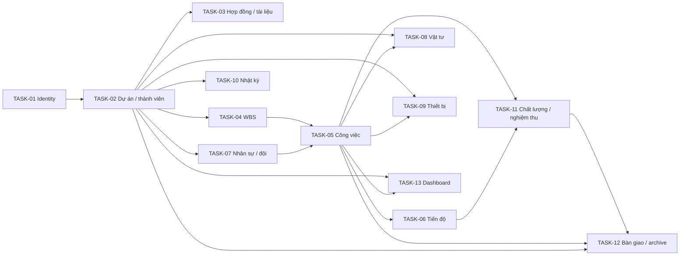

# Kiểm kê Task và Function — ConstructionProjectManagement

> **Phạm vi và cách đếm:** Báo cáo được lập bằng cách đối chiếu mã nguồn C#, Razor View, cấu hình, DbContext, migration và tài liệu hiện có. Một Function là một thao tác/nghiệp vụ người dùng hoặc endpoint độc lập; cặp GET/POST cùng tên tạo/xóa/sửa được tính là **một** Function. Method helper và method service là chi tiết triển khai, không cộng thêm lần nữa. Các chức năng framework Identity có cấu hình và liên kết giao diện nhưng không có source Razor/Controller Identity riêng trong project, được ghi nhận riêng.
>
> Có **14 nhóm Task** (12 nhóm nghiệp vụ trong tài liệu, một dashboard và một nhóm trang hệ thống), **63 Function MVC** và **2 luồng Identity UI** = **65 Function đang có bằng chứng trong source/cấu hình**. Ngoài ra, Phần IV ghi riêng **7 Function/khả năng còn thiếu hoặc cần xác nhận**, không cộng chúng vào số Function hiện có. Các Function có code nhưng chưa có kiểm thử theo từng luồng được gắn `NEEDS_TEST`; trạng thái đó không phủ nhận sự hiện diện của code.

## PHẦN I – TỔNG QUAN HỆ THỐNG

### Kiến trúc và công nghệ

- Một project web `ConstructionProjectManagement.csproj`, target `net10.0`; không thấy `.sln`/`.slnx` hoặc project test riêng.
- ASP.NET Core MVC + Razor Views; Identity UI/Razor Pages được đăng ký qua `AddDefaultIdentity` và `MapRazorPages`.
- EF Core 10.0.1 với provider SQLite; `Program.cs` gọi `UseSqlite`, connection string được đọc từ cấu hình và trỏ tới file SQLite. Không đưa giá trị connection string hay dữ liệu bí mật vào báo cáo.
- Các thư viện giao diện hiện diện trong `wwwroot/lib`: Bootstrap, jQuery, jquery-validation và jquery-validation-unobtrusive. Progress View gọi Chart.js từ CDN.
- Không có Repository layer, API Controller/REST area, custom middleware hoặc custom Identity Area được tìm thấy. Endpoint JSON duy nhất trong MVC là `ProgressController.ChartData`.
- Tầng tổng quát: Browser → Controller → (Service ở nhiều luồng ghi/nghiệp vụ) → `ApplicationDbContext`/EF Core → SQLite → View hoặc JSON. Nhiều action đọc dữ liệu trực tiếp qua DbContext; tài khoản thao tác qua Identity Manager.

### Thành phần được quét

| Thành phần | Số lượng/ghi nhận |
|---|---:|
| MVC Controller | 16 |
| Public MVC action method (GET/POST overload tính riêng ở mức method) | 91 |
| Function MVC sau khi gộp cặp GET/POST | 63 |
| Identity UI flow được cấu hình/liên kết | 2 (Login, Logout) |
| Service implementation | 13 |
| Service interface | 12 |
| Model/Entity/Enum file | 42 |
| ViewModel file | 14 |
| Razor View/partial | 63 |
| JavaScript riêng của ứng dụng | 1 (`site.js`; không có xử lý tùy chỉnh) |
| Test project/source test | Không tìm thấy |

### Bằng chứng kiểm thử và giới hạn

- `docs/05_Project_Management/Implementation_Progress.md` ghi 12 nghiệp vụ ở trạng thái code complete, nhưng tự kiểm thử chỉ `PARTIAL` và đều chờ người dùng test.
- `docs/07_Testing/Integration_Test_Matrix.md` ghi smoke test trang chủ, trang đăng nhập, migration SQLite và route bị chuyển về login khi chưa đăng nhập; ghi rõ chưa thay thế kiểm thử nghiệp vụ end-to-end.
- `docs/04_Testing/Test_Cases.md` là danh sách kết quả mong đợi, không phải kết quả chạy từng ca.
- Không chạy ứng dụng/test trong lượt kiểm kê: `Program.cs` tự áp dụng migration lúc khởi động, có thể thay đổi database; yêu cầu hiện tại chỉ phân tích và tạo báo cáo. Vì vậy không kết luận luồng CRUD/role chạy đúng chỉ từ việc có Action/Service/View.

### Khác biệt giữa tài liệu và source

- `README.md`, `AGENTS.md`, `docs/02_System_Design/System_Architecture.md`, `docs/03_Database/Database_Design.md` và một số test module cũ nói SQL Server/SQL Server Express.
- Source thực tế đăng ký SQLite trong `Program.cs`; `.csproj` loại `Migrations.SqlServer/**/*.cs` khỏi compile; `Migrations/` chứa migration SQLite. `Implementation_Progress.md` và integration matrix cũng ghi SQLite. Đây là sai khác tài liệu, không được tự chọn SQL Server làm runtime.
- Quy trình tài liệu nói kiểm thử HTTP và kiểm tra một số business rule, nhưng trạng thái các quy trình vẫn `READY_FOR_USER_TEST`/`WAITING_FOR_USER_TEST`; không có bằng chứng cho toàn bộ 65 luồng.

## PHẦN II – DANH MỤC TASK

| Mã Task | Tên Task | Mục đích/phạm vi | Model chính | Controller | Service chính | View chính | Phụ thuộc |
|---|---|---|---|---|---|---|---|
| TASK-01 | Tài khoản và Identity | Danh sách/tạo/sửa tài khoản, vai trò, trạng thái và hồ sơ; Login/Logout do Identity UI cung cấp | `ApplicationUser`, Identity Role, `RoleNames` | `AccountController`; Identity Razor Pages của package | Không có Account Service; `UserManager`/`RoleManager` | `Views/Account/*`, `Views/Shared/_LoginPartial.cshtml` | Nền tảng cho người thực hiện và Identity store |
| TASK-02 | Dự án và thành viên dự án | Danh sách, chi tiết, tạo/cập nhật dự án; xem/thêm thành viên | `Project`, `ProjectMember`, `ApplicationUser` | `ProjectsController`, `ProjectMembersController` | `IProjectService`/`ProjectService`; `IEmployeeService.AddProjectMemberAsync` | `Views/Projects/*`, `Views/ProjectMembers/Index.cshtml` | TASK-01 |
| TASK-03 | Hợp đồng và tài liệu | CRUD hợp đồng, tải lên/tải xuống tệp gắn dự án/hợp đồng | `Contract`, `ContractStatus`, `ProjectDocument`, `Project` | `ContractsController` | `IContractService`/`ContractService`; `IProjectDocumentService`/`ProjectDocumentService` | `Views/Contracts/*` | TASK-02 |
| TASK-04 | Giai đoạn và WBS | Xem cây, tạo giai đoạn và WorkItem/hạng mục WBS | `ProjectPhase`, `WorkItem`, `WbsItemStatus`, `Project` | `WbsController` | `IWbsService`/`WbsService` | `Views/Wbs/*` | TASK-02 |
| TASK-05 | Quản lý công việc | Danh sách/chi tiết/tạo/cập nhật công việc; gắn WBS, công việc cha và người dùng được phân công | `Task`, `TaskAssignment`, `TaskDependency`, `TaskPriority`, `TaskStatus` | `TasksController` | `ITaskService`/`TaskService` | `Views/Tasks/*` | TASK-02, TASK-04, TASK-07 |
| TASK-06 | Kế hoạch và tiến độ | Xem/cập nhật phần trăm/trạng thái, ghi lịch sử, hiển thị biểu đồ kế hoạch/thực tế | `Task`, `TaskProgressHistory`, `Project` | `ProgressController` | `IProgressService`/`ProgressService` | `Views/Progress/Index.cshtml` | TASK-05 |
| TASK-07 | Nhân sự và đội thi công | Hồ sơ nhân viên, liên kết phòng ban, đội thi công và thành viên đội | `Employee`, `Department`, `ConstructionTeam`, `TeamMember`, `ApplicationUser` | `EmployeesController`, `TeamsController` | `IEmployeeService`/`EmployeeService`; không có Team Service | `Views/Employees/*`, `Views/Teams/*` | TASK-01; liên kết nhân sự Task phụ thuộc TASK-02 |
| TASK-08 | Quản lý vật tư | Danh mục/tồn kho, tạo phiếu, duyệt/từ chối, xuất và lưu giao dịch | `Material`, `MaterialRequest`, `MaterialRequestItem`, `MaterialTransaction` và các enum | `MaterialsController` | `IMaterialService`/`MaterialService` | `Views/Materials/*` | TASK-02, TASK-05, TASK-01 |
| TASK-09 | Thiết bị thi công | Danh mục, bàn giao, thu hồi và chuyển thiết bị sang bảo trì | `Equipment`, `EquipmentAssignment`, `EquipmentStatus` | `EquipmentController` | `IEquipmentService`/`EquipmentService` | `Views/Equipment/*` | TASK-02, TASK-05, TASK-01 |
| TASK-10 | Nhật ký thi công | Danh sách/lọc, tạo/cập nhật nội dung nhật ký và nhận ảnh đính kèm | `ConstructionLog`, `Project`, `ApplicationUser` | `ConstructionLogsController` | `IConstructionLogService`/`ConstructionLogService` | `Views/ConstructionLogs/*` | TASK-02; có thể ghi chép dữ liệu Task nhưng không có FK Task trong `ConstructionLog` |
| TASK-11 | Chất lượng, sự cố, RFI và nghiệm thu | Tạo/xem sự cố, tạo/phản hồi RFI, yêu cầu và ghi kết quả inspection | `Incident`, `RfiRequest`, `InspectionRequest`, `InspectionHistory`, `Task` và status/priority enums | `QualityController` | `IQualityService`/`QualityService` | `Views/Quality/*` | TASK-02, TASK-05, TASK-06 |
| TASK-12 | Chi phí, hoàn thành và bàn giao | Tổng hợp chi phí/công việc mở, ghi chi phí, lập/xác nhận handover, archive project | `ProjectExpense`, `ProjectHandover`, `Project`, `Task`, `Incident`, `RfiRequest`, `InspectionRequest` | `CompletionController` | `ICompletionService`/`CompletionService` | `Views/Completion/*` | TASK-02, TASK-05, TASK-06, TASK-11 |
| TASK-13 | Dashboard | Tổng hợp chỉ số để hiển thị trang tổng quan | `DashboardViewModel`, các Entity dự án/công việc liên quan | `DashboardController` | `DashboardService` (không có interface riêng) | `Views/Dashboard/Index.cshtml` | Đọc dữ liệu từ TASK-02/TASK-05 và các nhóm liên quan |
| TASK-14 | Trang chủ và trang hệ thống | Trang chủ mặc định, quyền riêng tư, trang lỗi | `ErrorViewModel` | `HomeController` | Không có | `Views/Home/*`, `Views/Shared/Error.cshtml` | Không phụ thuộc nghiệp vụ |

## PHẦN III – DANH MỤC FUNCTION CHI TIẾT

**Quy ước trạng thái:** `IMPLEMENTED` chỉ dùng khi source có đường đi và tài liệu kiểm thử ghi nhận đúng endpoint/trang tương ứng; `NEEDS_TEST` là luồng source đã có nhưng chưa có bằng chứng test theo chức năng; `HAS_BUG` là có mâu thuẫn/lỗi luồng chứng minh được. Trạng thái ở đây không khẳng định chất lượng tổng thể hoặc tính an toàn của toàn hệ thống.

### TASK-01 — Tài khoản và Identity

| Mã Function | Tên Function | Mô tả | Controller/Action hoặc endpoint | Service/Method | View | Trạng thái |
|---|---|---|---|---|---|---|
| FN-01-01 | Đăng nhập | Trang đăng nhập Identity được cung cấp bởi package; không có PageModel local | Identity UI `/Account/Login`; cấu hình `Program.cs` (`AddDefaultIdentity`, `MapRazorPages`) | Identity package/`SignInManager`; không có Service local | `Views/Shared/_LoginPartial.cshtml` liên kết `/Account/Login`; trang thực tế từ Identity UI package | NEEDS_TEST — tài liệu ghi trang login trả 200, chưa ghi test credential hợp lệ/thất bại |
| FN-01-02 | Đăng xuất | Gửi form đăng xuất qua Identity Razor Page | Identity UI `/Account/Logout`; package, không có Controller local | Identity package/`SignInManager` | `Views/Shared/_LoginPartial.cshtml` | NEEDS_TEST |
| FN-01-03 | Xem danh sách tài khoản | Liệt kê tài khoản và vai trò hiện tại | `Controllers/AccountController.cs`, `AccountController.Index(CancellationToken)` | `UserManager.Users`, `GetRolesAsync`; không có Service | `Views/Account/Index.cshtml` | NEEDS_TEST |
| FN-01-04 | Tạo tài khoản và gán role | Form tạo tài khoản; tạo user Identity rồi gán role đã chọn | `AccountController.Create()` [GET], `AccountController.Create(AccountEditViewModel)` [POST] | `UserManager.CreateAsync`, `UserManager.AddToRoleAsync`; rollback user nếu gán role lỗi | `Views/Account/Create.cshtml`, `Views/Account/_AccountForm.cshtml` | NEEDS_TEST |
| FN-01-05 | Cập nhật tài khoản/role/trạng thái | Sửa thông tin, role và trạng thái tài khoản qua Identity | `AccountController.Edit(string)` [GET], `AccountController.Edit(string, AccountEditViewModel)` [POST] | `UserManager.FindByIdAsync`, `UpdateAsync`, `RemoveFromRolesAsync`, `AddToRoleAsync`; không có Service | `Views/Account/Edit.cshtml`, `Views/Account/_AccountForm.cshtml`, `Views/Account/Index.cshtml` | NEEDS_TEST |
| FN-01-06 | Xem/cập nhật hồ sơ cá nhân | Đọc và cập nhật profile tài khoản hiện hành | `AccountController.Profile()` [GET], `AccountController.Profile(ProfileViewModel)` [POST] | `UserManager.GetUserAsync`, `UpdateAsync` | `Views/Account/Profile.cshtml` | NEEDS_TEST |

### TASK-02 — Dự án và thành viên dự án

| Mã Function | Tên Function | Mô tả | Controller/Action | Service/Method | View | Trạng thái |
|---|---|---|---|---|---|---|
| FN-02-01 | Xem danh sách dự án | Trả dự án hiển thị được cho người dùng | `Controllers/ProjectsController.cs`, `ProjectsController.Index(CancellationToken)` | `IProjectService.GetVisibleProjectsAsync` → `ProjectService.GetVisibleProjectsAsync` | `Views/Projects/Index.cshtml` | NEEDS_TEST |
| FN-02-02 | Xem chi tiết dự án | Lấy dự án theo ID trong phạm vi hiển thị | `ProjectsController.Details(int, CancellationToken)` | `IProjectService.GetByIdAsync` → `ProjectService.GetByIdAsync` | `Views/Projects/Details.cshtml` | NEEDS_TEST |
| FN-02-03 | Tạo dự án | Hiển thị form và lưu dự án, người quản lý, danh sách thành viên | `ProjectsController.Create(CancellationToken)` [GET], `ProjectsController.Create(ProjectEditViewModel, CancellationToken)` [POST] | `IProjectService.CreateAsync` → `ProjectService.CreateAsync` | `Views/Projects/Create.cshtml`, `Views/Projects/_ProjectForm.cshtml` | NEEDS_TEST |
| FN-02-04 | Cập nhật dự án | Nạp dữ liệu hiện tại, kiểm tra và lưu thay đổi dự án/thành viên | `ProjectsController.Edit(int, CancellationToken)` [GET/POST overload] | `IProjectService.UpdateAsync` → `ProjectService.UpdateAsync`; GET nạp entity qua DbContext | `Views/Projects/Edit.cshtml`, `Views/Projects/_ProjectForm.cshtml` | NEEDS_TEST |
| FN-02-05 | Xem thành viên dự án | Nạp dự án chưa archive, thành viên và danh sách user có thể thêm | `Controllers/ProjectMembersController.cs`, `ProjectMembersController.Index(int, CancellationToken)` | Đọc trực tiếp `ApplicationDbContext` và `UserManager.Users` | `Views/ProjectMembers/Index.cshtml` | NEEDS_TEST |
| FN-02-06 | Thêm thành viên dự án | Thêm tài khoản đang hoạt động và ngăn thành viên trùng | `ProjectMembersController.Add(ProjectMemberViewModel, CancellationToken)` [POST] | `IEmployeeService.AddProjectMemberAsync` → `EmployeeService.AddProjectMemberAsync` | Form tại `Views/ProjectMembers/Index.cshtml` | NEEDS_TEST |

### TASK-03 — Hợp đồng và tài liệu

| Mã Function | Tên Function | Mô tả | Controller/Action | Service/Method | View | Trạng thái |
|---|---|---|---|---|---|---|
| FN-03-01 | Xem danh sách hợp đồng | Liệt kê hợp đồng thuộc phạm vi truy cập | `Controllers/ContractsController.cs`, `ContractsController.Index(CancellationToken)` | `IContractService.GetVisibleAsync` → `ContractService.GetVisibleAsync` | `Views/Contracts/Index.cshtml` | NEEDS_TEST |
| FN-03-02 | Xem chi tiết hợp đồng | Nạp hợp đồng và dữ liệu liên quan theo quyền hiển thị | `ContractsController.Details(int, CancellationToken)` | `IContractService.GetByIdAsync` → `ContractService.GetByIdAsync` | `Views/Contracts/Details.cshtml` | NEEDS_TEST |
| FN-03-03 | Tạo hợp đồng | Nạp danh sách dự án, kiểm tra và tạo hợp đồng | `ContractsController.Create(CancellationToken)` [GET], `ContractsController.Create(ContractEditViewModel, CancellationToken)` [POST] | `IContractService.CreateAsync` → `ContractService.CreateAsync` | `Views/Contracts/Create.cshtml`, `Views/Contracts/_ContractForm.cshtml` | NEEDS_TEST |
| FN-03-04 | Cập nhật hợp đồng | Nạp và cập nhật hợp đồng hiện có | `ContractsController.Edit(int, CancellationToken)` [GET/POST overload] | `IContractService.UpdateAsync` → `ContractService.UpdateAsync` | `Views/Contracts/Edit.cshtml`, `Views/Contracts/_ContractForm.cshtml` | NEEDS_TEST |
| FN-03-05 | Tải tài liệu lên | Kiểm tra dự án/quyền, extension và dung lượng; lưu file ngoài `wwwroot`, metadata vào DB | `ContractsController.UploadDocument(...)` [POST] | `IProjectDocumentService.UploadAsync` → `ProjectDocumentService.UploadAsync` | Form tại `Views/Contracts/Details.cshtml` | NEEDS_TEST |
| FN-03-06 | Tải tài liệu xuống | Kiểm tra document, trạng thái archive và quyền dự án trước khi trả file | `ContractsController.DownloadDocument(int, CancellationToken)` | `IProjectDocumentService.GetDownloadAsync` → `ProjectDocumentService.GetDownloadAsync` | Link tại `Views/Contracts/Details.cshtml` | NEEDS_TEST |

### TASK-04 — Giai đoạn và WBS

| Mã Function | Tên Function | Mô tả | Controller/Action | Service/Method | View | Trạng thái |
|---|---|---|---|---|---|---|
| FN-04-01 | Xem cây WBS | Nạp dự án/giai đoạn/hạng mục theo phạm vi truy cập | `Controllers/WbsController.cs`, `WbsController.Index(int?, CancellationToken)` | `IWbsService.GetProjectTreeAsync` → `WbsService.GetProjectTreeAsync` | `Views/Wbs/Index.cshtml` | NEEDS_TEST |
| FN-04-02 | Tạo giai đoạn dự án | Form và lưu `ProjectPhase` thuộc dự án hợp lệ | `WbsController.CreatePhase(int, CancellationToken)` [GET], `WbsController.CreatePhase(ProjectPhaseViewModel, CancellationToken)` [POST] | `IWbsService.CreatePhaseAsync` → `WbsService.CreatePhaseAsync` | `Views/Wbs/CreatePhase.cshtml` | NEEDS_TEST |
| FN-04-03 | Tạo hạng mục WBS | Form và lưu WorkItem, dự án/giai đoạn/cấp cha và mã WBS | `WbsController.CreateItem(int, CancellationToken)` [GET], `WbsController.CreateItem(WorkItemViewModel, CancellationToken)` [POST] | `IWbsService.CreateWorkItemAsync` → `WbsService.CreateWorkItemAsync` | `Views/Wbs/CreateItem.cshtml` | NEEDS_TEST |

### TASK-05 — Quản lý công việc

| Mã Function | Tên Function | Mô tả | Controller/Action | Service/Method | View | Trạng thái |
|---|---|---|---|---|---|---|
| FN-05-01 | Xem danh sách công việc | Truy vấn Task trong phạm vi dự án/người dùng | `Controllers/TasksController.cs`, `TasksController.Index(CancellationToken)` | `ITaskService.GetVisibleAsync` → `TaskService.GetVisibleAsync` | `Views/Tasks/Index.cshtml` | NEEDS_TEST |
| FN-05-02 | Xem chi tiết công việc | Nạp Task trong phạm vi nhìn thấy | `TasksController.Details(int, CancellationToken)` | `ITaskService.GetByIdAsync` → `TaskService.GetByIdAsync` | `Views/Tasks/Details.cshtml` | NEEDS_TEST |
| FN-05-03 | Tạo công việc và phân công user | Kiểm tra Project/WBS/parent/date/status/assignee rồi tạo Task và TaskAssignment | `TasksController.Create(CancellationToken)` [GET], `TasksController.Create(TaskEditViewModel, CancellationToken)` [POST] | `ITaskService.CreateAsync` → `TaskService.CreateAsync`, `ValidateAsync`, `BuildAssignments` | `Views/Tasks/Create.cshtml`, `Views/Tasks/_TaskForm.cshtml` | NEEDS_TEST |
| FN-05-04 | Cập nhật công việc và danh sách assignee | Cập nhật thông tin Task; thay toàn bộ TaskAssignment hiện có bằng danh sách gửi lên | `TasksController.Edit(int, CancellationToken)` [GET/POST overload] | `ITaskService.UpdateAsync` → `TaskService.UpdateAsync`, `ValidateAsync`, `BuildAssignments` | `Views/Tasks/Edit.cshtml`, `Views/Tasks/_TaskForm.cshtml` | NEEDS_TEST |

### TASK-06 — Kế hoạch và tiến độ

| Mã Function | Tên Function | Mô tả | Controller/Action hoặc endpoint | Service/Method | View | Trạng thái |
|---|---|---|---|---|---|---|
| FN-06-01 | Xem tiến độ công việc | Liệt kê task nhìn thấy và form cập nhật phần trăm/trạng thái/lý do chậm | `Controllers/ProgressController.cs`, `ProgressController.Index(CancellationToken)` | `IProgressService.GetVisibleTasksAsync` → `ProgressService.GetVisibleTasksAsync` | `Views/Progress/Index.cshtml` | NEEDS_TEST |
| FN-06-02 | Cập nhật tiến độ | Lưu %/status, lịch sử trước-sau, người cập nhật và mốc thực tế | `ProgressController.Update(...)` [POST] | `IProgressService.UpdateAsync` → `ProgressService.UpdateAsync` | Form trong `Views/Progress/Index.cshtml` | NEEDS_TEST |
| FN-06-03 | Lấy dữ liệu biểu đồ | Trả các điểm planned/actual theo dự án; được gọi bằng `fetch` | `ProgressController.ChartData(CancellationToken)` [GET] | `IProgressService.GetChartAsync` → `ProgressService.GetChartAsync`, `CalculatePlannedPercent` | Inline script trong `Views/Progress/Index.cshtml`; không dùng `wwwroot/js/site.js` | NEEDS_TEST |

### TASK-07 — Nhân sự và đội thi công

| Mã Function | Tên Function | Mô tả | Controller/Action | Service/Method | View | Trạng thái |
|---|---|---|---|---|---|---|
| FN-07-01 | Xem danh sách nhân viên | Liệt kê employee kèm user và department | `Controllers/EmployeesController.cs`, `EmployeesController.Index(CancellationToken)` | `IEmployeeService.GetEmployeesAsync` → `EmployeeService.GetEmployeesAsync` | `Views/Employees/Index.cshtml` | NEEDS_TEST |
| FN-07-02 | Tạo hồ sơ nhân viên | Chọn Identity user/department và lưu mã, chức vụ, điện thoại, ngày vào làm, active | `EmployeesController.Create(CancellationToken)` [GET], `EmployeesController.Create(EmployeeEditViewModel, CancellationToken)` [POST] | `IEmployeeService.SaveAsync` → `EmployeeService.SaveAsync`; `GetDepartmentsAsync` nạp lựa chọn | `Views/Employees/Create.cshtml`, `Views/Employees/_EmployeeForm.cshtml` | NEEDS_TEST |
| FN-07-03 | Cập nhật hồ sơ nhân viên | Nạp và lưu thay đổi Employee | `EmployeesController.Edit(int, CancellationToken)` [GET/POST overload] | `IEmployeeService.SaveAsync` → `EmployeeService.SaveAsync`; GET đọc DbContext trực tiếp | `Views/Employees/Edit.cshtml`, `Views/Employees/_EmployeeForm.cshtml` | NEEDS_TEST |
| FN-07-04 | Xem đội và thành viên | Nạp danh sách đội, member/employee/user và nhân viên hoạt động để chọn | `Controllers/TeamsController.cs`, `TeamsController.Index(CancellationToken)` | Không có Service; truy vấn `ApplicationDbContext` trực tiếp | `Views/Teams/Index.cshtml` | NEEDS_TEST |
| FN-07-05 | Tạo đội thi công | Kiểm tra ModelState rồi tạo `ConstructionTeam` | `TeamsController.Create()` [GET], `TeamsController.Create(TeamEditViewModel, CancellationToken)` [POST] | Không có Service; `dbContext.ConstructionTeams.Add`/`SaveChangesAsync` | `Views/Teams/Create.cshtml` | NEEDS_TEST |
| FN-07-06 | Thêm nhân viên vào đội | Thêm `TeamMember` khi employee/user đang hoạt động và chưa trùng | `TeamsController.AddMember(TeamMemberAddViewModel, CancellationToken)` [POST] | Không có Service; kiểm tra và ghi trực tiếp qua DbContext | Form trong `Views/Teams/Index.cshtml` | NEEDS_TEST |

### TASK-08 — Quản lý vật tư

| Mã Function | Tên Function | Mô tả | Controller/Action | Service/Method | View | Trạng thái |
|---|---|---|---|---|---|---|
| FN-08-01 | Xem vật tư và phiếu yêu cầu | Nạp danh mục và tối đa 100 request gần nhất | `Controllers/MaterialsController.cs`, `MaterialsController.Index(CancellationToken)` | Không có query Service; đọc `ApplicationDbContext` trực tiếp | `Views/Materials/Index.cshtml` | NEEDS_TEST |
| FN-08-02 | Tạo vật tư | Kiểm tra mã trùng rồi tạo danh mục vật tư | `MaterialsController.Create()` [GET], `MaterialsController.Create(MaterialEditViewModel, CancellationToken)` [POST] | `IMaterialService.SaveMaterialAsync` → `MaterialService.SaveMaterialAsync` | `Views/Materials/Create.cshtml`, `Views/Materials/_Form.cshtml` | NEEDS_TEST |
| FN-08-03 | Cập nhật vật tư | Nạp dữ liệu hiện có và cập nhật danh mục | `MaterialsController.Edit(int, CancellationToken)` [GET/POST overload] | `IMaterialService.SaveMaterialAsync` → `MaterialService.SaveMaterialAsync`; GET đọc DbContext trực tiếp | `Views/Materials/Edit.cshtml`, `Views/Materials/_Form.cshtml` | NEEDS_TEST |
| FN-08-04 | Tạo phiếu yêu cầu vật tư | Chọn dự án/công việc/vật tư; kiểm tra dự án và dòng vật tư rồi lưu request/items | `MaterialsController.CreateRequest(CancellationToken)` [GET], `MaterialsController.CreateRequest(MaterialRequestCreateViewModel, CancellationToken)` [POST] | `IMaterialService.CreateRequestAsync` → `MaterialService.CreateRequestAsync` | `Views/Materials/Request.cshtml` | NEEDS_TEST |
| FN-08-05 | Duyệt phiếu | Chuyển phiếu Pending sang Approved | `MaterialsController.Approve(int, CancellationToken)` [POST] | `ChangeStatusAsync` → `IMaterialService.SetRequestStatusAsync` → `MaterialService.SetRequestStatusAsync` | Form trong `Views/Materials/Index.cshtml` | NEEDS_TEST |
| FN-08-06 | Từ chối phiếu | Chuyển phiếu Pending sang Rejected | `MaterialsController.Reject(int, CancellationToken)` [POST] | `ChangeStatusAsync` → `IMaterialService.SetRequestStatusAsync` → `MaterialService.SetRequestStatusAsync` | Form trong `Views/Materials/Index.cshtml` | NEEDS_TEST |
| FN-08-07 | Xuất vật tư | Chỉ xuất phiếu đã duyệt; kiểm tồn, cập nhật tồn, số lượng đã cấp và transaction trong DB transaction | `MaterialsController.Issue(int, CancellationToken)` [POST] | `IMaterialService.IssueRequestAsync` → `MaterialService.IssueRequestAsync` | Form trong `Views/Materials/Index.cshtml` | NEEDS_TEST |

### TASK-09 — Thiết bị thi công

| Mã Function | Tên Function | Mô tả | Controller/Action | Service/Method | View | Trạng thái |
|---|---|---|---|---|---|---|
| FN-09-01 | Xem thiết bị và lần bàn giao đang mở | Nạp thiết bị và EquipmentAssignment chưa thu hồi | `Controllers/EquipmentController.cs`, `EquipmentController.Index(CancellationToken)` | Không có query Service; đọc DbContext trực tiếp | `Views/Equipment/Index.cshtml` | NEEDS_TEST |
| FN-09-02 | Tạo thiết bị | Thêm thiết bị sau kiểm tra mã trùng | `EquipmentController.Create()` [GET], `EquipmentController.Create(EquipmentEditViewModel, CancellationToken)` [POST] | `IEquipmentService.SaveAsync` → `EquipmentService.SaveAsync` | `Views/Equipment/Create.cshtml`, `Views/Equipment/_Form.cshtml` | NEEDS_TEST |
| FN-09-03 | Cập nhật thiết bị | Cập nhật metadata/trạng thái; cấm đổi trạng thái khi đang InUse | `EquipmentController.Edit(int, CancellationToken)` [GET/POST overload] | `IEquipmentService.SaveAsync` → `EquipmentService.SaveAsync`; GET đọc DbContext trực tiếp | `Views/Equipment/Edit.cshtml`, `Views/Equipment/_Form.cshtml` | NEEDS_TEST |
| FN-09-04 | Bàn giao thiết bị | Chọn thiết bị Available, dự án/công việc/người nhận; lưu lịch sử và chuyển InUse | `EquipmentController.Assign(CancellationToken)` [GET], `EquipmentController.Assign(EquipmentAssignmentViewModel, CancellationToken)` [POST] | `IEquipmentService.AssignAsync` → `EquipmentService.AssignAsync` | `Views/Equipment/Assign.cshtml` | NEEDS_TEST |
| FN-09-05 | Thu hồi thiết bị | Ghi thời gian/người thu hồi và đưa thiết bị về Available | `EquipmentController.Return(int, CancellationToken)` [POST] | `IEquipmentService.ReturnAsync` → `EquipmentService.ReturnAsync` | Form trong `Views/Equipment/Index.cshtml` | NEEDS_TEST |
| FN-09-06 | Chuyển thiết bị sang bảo trì | Gọi cập nhật trạng thái Maintenance, không cho đổi trạng thái đang InUse | `EquipmentController.SetMaintenance(int, CancellationToken)` [POST] | `IEquipmentService.SetStatusAsync` → `EquipmentService.SetStatusAsync` | Form trong `Views/Equipment/Index.cshtml` | NEEDS_TEST |

### TASK-10 — Nhật ký thi công

| Mã Function | Tên Function | Mô tả | Controller/Action | Service/Method | View | Trạng thái |
|---|---|---|---|---|---|---|
| FN-10-01 | Xem/lọc nhật ký | Liệt kê tối đa 100 log, tùy chọn lọc theo project | `Controllers/ConstructionLogsController.cs`, `ConstructionLogsController.Index(int?, CancellationToken)` | Không có query Service; đọc DbContext trực tiếp | `Views/ConstructionLogs/Index.cshtml` | NEEDS_TEST |
| FN-10-02 | Tạo nhật ký | Lưu ngày, thời tiết, nhân lực, việc làm, vật tư/thiết bị, vấn đề và ảnh tùy chọn | `ConstructionLogsController.Create(CancellationToken)` [GET], `ConstructionLogsController.Create(ConstructionLogEditViewModel, CancellationToken)` [POST] | `IConstructionLogService.SaveAsync` → `ConstructionLogService.SaveAsync` | `Views/ConstructionLogs/Create.cshtml`, `Views/ConstructionLogs/_Form.cshtml` | NEEDS_TEST |
| FN-10-03 | Cập nhật nhật ký | Nạp và cập nhật nội dung log; form cho phép gửi ảnh mới | `ConstructionLogsController.Edit(int, CancellationToken)` [GET/POST overload] | `IConstructionLogService.SaveAsync` → `ConstructionLogService.SaveAsync`; GET nạp DB trực tiếp | `Views/ConstructionLogs/Edit.cshtml`, `Views/ConstructionLogs/_Form.cshtml` | NEEDS_TEST |

### TASK-11 — Chất lượng, sự cố, RFI và nghiệm thu

| Mã Function | Tên Function | Mô tả | Controller/Action | Service/Method | View | Trạng thái |
|---|---|---|---|---|---|---|
| FN-11-01 | Xem danh sách chất lượng | Hiển thị tối đa 100 sự cố, RFI và inspection | `Controllers/QualityController.cs`, `QualityController.Index(CancellationToken)` | Không có query Service; đọc DbContext trực tiếp | `Views/Quality/Index.cshtml` | NEEDS_TEST |
| FN-11-02 | Tạo sự cố | Ghi incident theo project/task, nội dung, priority, người báo cáo và assignee tùy chọn | `QualityController.CreateIncident(CancellationToken)` [GET], `QualityController.CreateIncident(IncidentCreateViewModel, CancellationToken)` [POST] | `IQualityService.CreateIncidentAsync` → `QualityService.CreateIncidentAsync` | `Views/Quality/CreateIncident.cshtml` | NEEDS_TEST |
| FN-11-03 | Tạo RFI | Tạo câu hỏi RFI thuộc project/task | `QualityController.CreateRfi(CancellationToken)` [GET], `QualityController.CreateRfi(RfiCreateViewModel, CancellationToken)` [POST] | `IQualityService.CreateRfiAsync` → `QualityService.CreateRfiAsync` | `Views/Quality/CreateRfi.cshtml` | NEEDS_TEST |
| FN-11-04 | Phản hồi RFI | Ghi response/người phản hồi/thời điểm; Service chuyển trạng thái sang Answered | `QualityController.RespondRfi(int)` [GET], `QualityController.RespondRfi(int, RfiRespondViewModel, CancellationToken)` [POST] | `IQualityService.RespondRfiAsync` → `QualityService.RespondRfiAsync` | `Views/Quality/RespondRfi.cshtml`, liên kết từ `Views/Quality/Index.cshtml` | NEEDS_TEST |
| FN-11-05 | Tạo yêu cầu nghiệm thu | Tạo inspection cho task có `RequiresInspection`, task chuyển PendingInspection | `QualityController.CreateInspection(CancellationToken)` [GET], `QualityController.CreateInspection(InspectionCreateViewModel, CancellationToken)` [POST] | `IQualityService.CreateInspectionAsync` → `QualityService.CreateInspectionAsync` | `Views/Quality/CreateInspection.cshtml` | NEEDS_TEST |
| FN-11-06 | Ghi kết quả nghiệm thu | Ghi Passed/Failed, notes/khắc phục và InspectionHistory; cập nhật trạng thái Task | `QualityController.RecordInspection(int, InspectionResultViewModel, CancellationToken)` [POST] | `IQualityService.RecordInspectionAsync` → `QualityService.RecordInspectionAsync` | Inline form ở `Views/Quality/Index.cshtml` | NEEDS_TEST |

### TASK-12 — Chi phí, hoàn thành và bàn giao

| Mã Function | Tên Function | Mô tả | Controller/Action | Service/Method | View | Trạng thái |
|---|---|---|---|---|---|---|
| FN-12-01 | Xem tổng hợp hoàn thành | Nạp dự án, 100 khoản chi/handover/task mở gần nhất và tổng chi phí | `Controllers/CompletionController.cs`, `CompletionController.Index(CancellationToken)` | Không có query Service; tổng hợp trực tiếp trong Controller bằng DbContext | `Views/Completion/Index.cshtml` | NEEDS_TEST |
| FN-12-02 | Ghi nhận khoản chi | Lưu khoản chi của dự án đang hoạt động | `CompletionController.CreateExpense(CancellationToken)` [GET], `CompletionController.CreateExpense(ExpenseCreateViewModel, CancellationToken)` [POST] | `ICompletionService.AddExpenseAsync` → `CompletionService.AddExpenseAsync` | `Views/Completion/CreateExpense.cshtml` | NEEDS_TEST |
| FN-12-03 | Lập hồ sơ bàn giao | Kiểm tra không còn task mở rồi lưu hồ sơ/người nhận | `CompletionController.CreateHandover(CancellationToken)` [GET], `CompletionController.CreateHandover(HandoverCreateViewModel, CancellationToken)` [POST] | `ICompletionService.CreateHandoverAsync` → `CompletionService.CreateHandoverAsync` | `Views/Completion/CreateHandover.cshtml` | NEEDS_TEST |
| FN-12-04 | Xác nhận bàn giao | Đánh dấu hồ sơ đã xác nhận và thời điểm xác nhận | `CompletionController.ConfirmHandover(int, CancellationToken)` [POST] | `ICompletionService.ConfirmHandoverAsync` → `CompletionService.ConfirmHandoverAsync` | Form trong `Views/Completion/Index.cshtml` | NEEDS_TEST |
| FN-12-05 | Đóng/lưu trữ dự án | Yêu cầu handover đã xác nhận và không còn Task/Incident/RFI/inspection mở; sau đó đánh dấu archive/completed | `CompletionController.Archive(int, CancellationToken)` [POST] | `ICompletionService.ArchiveProjectAsync` → `CompletionService.ArchiveProjectAsync` | Form trong `Views/Completion/Index.cshtml` | HAS_BUG — các luồng Incident/RFI hiện không có thao tác chuyển sang trạng thái đóng cần thiết; xem GAP-01/GAP-02 |

### TASK-13 — Dashboard

| Mã Function | Tên Function | Mô tả | Controller/Action | Service/Method | View | Trạng thái |
|---|---|---|---|---|---|---|
| FN-13-01 | Xem dashboard tổng quan | Tổng hợp thông tin hệ thống vào `DashboardViewModel` | `Controllers/DashboardController.cs`, `DashboardController.Index(CancellationToken)` | `DashboardService.GetSummaryAsync` (không có interface) | `Views/Dashboard/Index.cshtml` | NEEDS_TEST |

### TASK-14 — Trang chủ và trang hệ thống

| Mã Function | Tên Function | Mô tả | Controller/Action | Service/Method | View/Endpoint | Trạng thái |
|---|---|---|---|---|---|---|
| FN-14-01 | Trang chủ | Trang mặc định trả nội dung Home | `Controllers/HomeController.cs`, `HomeController.Index()` | Không có | `Views/Home/Index.cshtml`, route `/` | IMPLEMENTED — `Integration_Test_Matrix.md` ghi `/` trả HTTP 200 |
| FN-14-02 | Trang quyền riêng tư | Trả trang Privacy | `HomeController.Privacy()` | Không có | `Views/Home/Privacy.cshtml` | NEEDS_TEST |
| FN-14-03 | Trang lỗi | Trả trang Error và `ErrorViewModel` | `HomeController.Error()` | Không có | `Views/Shared/Error.cshtml` | NEEDS_TEST |

## PHẦN IV – CÁC FUNCTION CÒN THIẾU

Các dòng sau **không** được tính vào 65 Function hiện có. Đây là khoảng trống/chức năng cần xác nhận, được suy ra từ quy tắc tài liệu, entity/status được lưu hoặc điều kiện nghiệp vụ khác trong source.

| Mã | Function/khả năng | Trạng thái | Bằng chứng cụ thể | Ảnh hưởng/ghi chú |
|---|---|---|---|---|
| GAP-01 | Chuyển Incident sang Resolved/Closed, ghi Resolution/ResolvedAt | NOT_FOUND | `Models/Incident.cs` có `Status`, `Resolution`, `ResolvedAt`; `IncidentStatus` có Resolved/Closed; `QualityService` chỉ có `CreateIncidentAsync`; `QualityController` không có action cập nhật/đóng Incident | `CompletionService.ArchiveProjectAsync` chặn archive nếu Incident khác Resolved/Closed; Incident được tạo mới mặc định Open nên thiếu luồng xử lý làm cản trở archive |
| GAP-02 | Đóng/hoàn tất RFI | NOT_FOUND | `RfiStatus` có Closed; `QualityService.RespondRfiAsync` chỉ đặt Answered; không có Close action/service; `Views/Quality/Index.cshtml` chỉ cho Respond khi khác Closed | Archive yêu cầu mọi RFI là Closed; RFI đã Answered không có thao tác chuyển Closed |
| GAP-03 | Xem/tải ảnh đính kèm nhật ký | PARTIAL | `ConstructionLogService.SaveAsync` lưu file vào `App_Data/ConstructionLogs` và metadata; `ConstructionLogsController` không có download action; `Views/ConstructionLogs/Index.cshtml` không hiển thị link/ảnh | Có thể tải lên nhưng không thấy luồng truy cập lại ảnh từ UI; cần xác nhận mục tiêu chỉ lưu hay phải xem/tải |
| GAP-04 | Quản lý phụ thuộc giữa Task (tạo/sửa/xóa quan hệ predecessor) | UNCLEAR | `TaskDependency` có trong `Models/`, `DbSet` và quan hệ `ApplicationDbContext`; không có tham chiếu từ Controller/Service/ViewModel/View; Business 05 hiện mô tả Task cha-con/assignment nhưng không đặc tả rõ predecessor | Có dữ liệu Entity nhưng chưa có quy trình; cần xác nhận có yêu cầu quản lý dependency hay chỉ là schema dự kiến |
| GAP-05 | Quản trị danh mục Department | UNCLEAR | `Department` có Entity/DbSet; `EmployeeService.GetDepartmentsAsync` chỉ đọc để đổ dropdown; không có Department Controller/Service create/update/seed; tài liệu Business 07 nói tên phòng ban được quản lý duy nhất | Không biết danh mục được cấp từ bên ngoài hay phải quản trị trong ứng dụng; hiện source không bảo đảm có lựa chọn phòng ban ban đầu |
| GAP-06 | Giao Task cho cả đội thi công | UNCLEAR | `docs/06_Diagrams/08_Process_02_Task_Execution.mmd` thể hiện phân công “nhân sự/đội”; `TaskAssignment` chỉ FK tới `ApplicationUser`, ViewModel chỉ có `AssigneeIds`; không có Task-Team relationship | Tài liệu sơ đồ và mô hình phân công không khớp; Business 05 chỉ ghi phân công nhân viên, cần chốt phạm vi |
| GAP-07 | Archive/khôi phục Contract và ProjectDocument | UNCLEAR | `Contract`/`ProjectDocument` có `IsArchived`; query/download loại bản ghi archived; không tìm thấy action/service đổi trạng thái hoặc khôi phục | Chưa thấy tài liệu nghiệp vụ yêu cầu thao tác archive riêng cho hai loại này; cần xác nhận có dùng field hay chưa triển khai |

## PHẦN V – CÁC VẤN ĐỀ PHÁT HIỆN

1. **Luồng archive có thể bị khóa bởi Incident/RFI (nghiêm trọng nhất).** `CompletionService.ArchiveProjectAsync` chỉ cho archive khi Incident đã Resolved/Closed và RFI đã Closed. `QualityService` hiện chỉ tạo Incident, tạo RFI và phản hồi RFI (đặt Answered); không có thao tác đóng Incident/RFI. Vì vậy, khi dự án có các bản ghi này, UI hiện tại không cung cấp bước chuyển trạng thái để thỏa điều kiện archive. Bằng chứng: `Services/CompletionService.cs::ArchiveProjectAsync`, `Services/QualityService.cs::CreateIncidentAsync`, `Services/QualityService.cs::RespondRfiAsync`, `Controllers/QualityController.cs`, `Views/Quality/Index.cshtml`.
2. **Kiểm tra quyền theo project không đồng nhất giữa các query.** `ProjectService.GetVisibleProjectsAsync`, `TaskService.VisibleQuery`, `ProgressService.VisibleQuery` và `WbsService` lọc phạm vi dữ liệu; trong khi các trang tổng hợp đọc thẳng DbContext như `CompletionController.Index`, `MaterialsController.Index`, `QualityController.Index`, `ConstructionLogsController.Index` và `EquipmentController.Index` không áp dụng cùng bộ lọc thành viên/project ở query. Cần xác nhận đây là chủ ý cho các role toàn hệ thống hay thiếu lọc phạm vi.
3. **ProjectMembers Index chỉ kiểm tra role và project tồn tại, không gọi quyền truy cập theo project.** `ProjectMembersController.Index(int, CancellationToken)` đọc Project và danh sách user trực tiếp; `Add` gọi `EmployeeService.AddProjectMemberAsync`, hàm này kiểm tra project/user/duplicate nhưng không nhận caller identity để xác thực caller thuộc phạm vi project. Đây là điểm cần rà soát trước khi dùng quyền theo project; báo cáo không chạy thử truy cập trái phép.
4. **TaskService cập nhật lấy entity theo ID trước khi kiểm tra quyền với project hiện tại.** `TaskService.UpdateAsync` nạp `existing` bằng ID không qua `VisibleQuery`, sau đó `ValidateAsync` kiểm tra project ID trong model được gửi. Cần xác minh quyền trên bản ghi hiện tại và luồng cập nhật qua test được cấp quyền phù hợp; chưa thực hiện thử nghiệm.
5. **Ràng buộc mã phòng ban trong tài liệu chưa được cấu hình ở source.** Business 07 nói tên phòng ban duy nhất; `Department` chỉ có `[MaxLength(100)]`, `ApplicationDbContext` không cấu hình unique index cho `Department.Name`, không có CRUD/seed Department.
6. **Lưu Employee có thể vấp unique constraint mà Service không chuyển thành lỗi form.** `ApplicationDbContext` đặt unique index cho `Employee.UserId`; `EmployeeService.SaveAsync` kiểm tra trùng `EmployeeCode` nhưng không kiểm tra user đã gắn với một Employee khác trước `SaveChangesAsync`. Kết quả vi phạm index có thể phát sinh exception thay vì thông báo nghiệp vụ.
7. **Thêm thành viên đội có nhánh thất bại im lặng.** `TeamsController.AddMember` chỉ ghi khi employee hợp lệ và không trùng, nhưng luôn redirect và không tạo TempData/model error ở nhánh không hợp lệ/trùng; `Views/Teams/Index.cshtml` không cho biết vì sao không thêm được. Đồng thời action không kiểm tra rõ `TeamId` tồn tại trước khi insert.
8. **Các thao tác file không có bù trừ khi lưu DB lỗi.** `ProjectDocumentService.UploadAsync` và `ConstructionLogService.SaveAsync` ghi file vật lý trước `SaveChangesAsync`; nếu lưu DB thất bại có thể còn file mồ côi. Khi thay ảnh nhật ký, source không xóa file cũ. Đây là rủi ro vòng đời file, chưa kiểm tra runtime.
9. **Xử lý lỗi phía client của biểu đồ chưa đầy đủ.** `Views/Progress/Index.cshtml` gọi CDN Chart.js và `fetch(ChartData)` nhưng không kiểm tra HTTP status/`.catch`; lỗi CDN/JSON/network không có thông báo trên giao diện. `wwwroot/js/site.js` hiện chỉ có comment khung, không triển khai fallback.
10. **Đọc/ghi nghiệp vụ được chia giữa Controller và Service.** Nhiều service xử lý ghi/validation, nhưng index/detail/options vẫn query DbContext trong Controller; `TeamsController` thực hiện cả tạo đội/thêm thành viên trực tiếp; `AccountController` thao tác Identity trực tiếp. Đây là hiện trạng kiến trúc, không phải kết luận mọi logic Controller đều sai.
11. **Không tìm thấy View/action DELETE hoặc PUT.** Các thao tác ghi MVC hiện dùng POST; một số nghiệp vụ dùng `IsActive`/`IsArchived`, nhưng không có Delete workflow chung. Không xem đây là thiếu nếu tài liệu chỉ yêu cầu lưu trữ mềm.
12. **Không phát hiện form/action nghiệp vụ bị trỏ tới một action không có trong source khi đối chiếu Razor `asp-action` với Controller.** Các action phục vụ từ form Index (Archive, ConfirmHandover, Return, SetMaintenance, RecordInspection) không có View riêng nhưng có form tương ứng. `ChartData` được inline `fetch` gọi; Identity Login/Logout đến từ package.
13. **Không thấy Service implementation nào hoàn toàn không được đăng ký/tiêm trong ứng dụng.** 12 service interface được đăng ký trong `Program.cs`; `DashboardService` được đăng ký trực tiếp. `TaskDependency` là dữ liệu chưa có flow, không phải một Service “bị bỏ quên”.

## PHẦN VI – MỐI LIÊN KẾT GIỮA CÁC TASK

### Phụ thuộc dữ liệu và quy trình

- **TASK-01 → TASK-02/TASK-07:** Identity user/role là nguồn người dùng cho Project Manager, project member, Employee, assignee và audit field.
- **TASK-02 → TASK-03/TASK-04/TASK-05/TASK-08/TASK-09/TASK-10/TASK-11/TASK-12:** Project là khóa liên kết của hợp đồng, WBS, Task, request vật tư, thiết bị, nhật ký, sự cố/RFI/inspection, chi phí và handover.
- **TASK-04 → TASK-05:** `Task.WorkItemId` liên kết WBS; Service kiểm tra WorkItem cùng project.
- **TASK-05 → TASK-06/TASK-08/TASK-09/TASK-11/TASK-12:** Task được theo dõi tiến độ, gắn request/assignment liên quan, có thể cần nghiệm thu, và là điều kiện đóng dự án.
- **TASK-07 → TASK-02/TASK-05:** Employee/Identity user tham gia project và được phân công Task; hiện TaskAssignment gắn User chứ không gắn Team.
- **TASK-11 → TASK-06/TASK-12:** Inspection cập nhật Task sang Completed/NeedsRework; Incident/RFI/inspection đang mở được dùng làm điều kiện chặn archive.
- **TASK-08/TASK-09/TASK-10** ghi hoạt động theo Project; hiện Material/Equipment có FK Task tùy chọn, còn `ConstructionLog` không có TaskId.
- **TASK-13** tổng hợp các dữ liệu liên miền; **TASK-14** là giao diện hệ thống, không phải nghiệp vụ dự án.

## PHẦN VII – ĐỀ XUẤT THỨ TỰ XÂY DỰNG

Đây là thứ tự ưu tiên để **hoàn thiện và kiểm chứng** các Task hiện hữu; không phải yêu cầu triển khai ngay.

| Thứ tự | Task | Lý do |
|---:|---|---|
| 1 | TASK-01 — Tài khoản và Identity | Tạo/đăng nhập user là nền cho người quản lý, thành viên, nhân viên và actor audit. Trước khi mở rộng Role–Task–Function cần kiểm chứng luồng account/profile cơ bản. |
| 2 | TASK-02 — Dự án và thành viên | Là aggregate gốc; scope project được các module khác sử dụng. Cần làm rõ quyền truy cập member theo project và kiểm thử create/update/member. |
| 3 | TASK-07 — Nhân sự và đội | Cung cấp Employee/Department và người được phân công; cần xác nhận nguồn dữ liệu Department và xử lý trùng user trước khi dùng cho Task. |
| 4 | TASK-03 — Hợp đồng và tài liệu | Phụ thuộc Project; kiểm chứng lưu/tải file, quyền truy cập và tính nhất quán file-DB trước khi tích lũy dữ liệu. |
| 5 | TASK-04 — Giai đoạn và WBS | Tạo cấu trúc phân rã làm đầu vào Task; hiện chỉ có create/view, kiểm tra có cần update/archive hay không. |
| 6 | TASK-05 — Quản lý công việc | Trung tâm luồng thi công, phụ thuộc Project/WBS/nhân sự; cần xác nhận TaskDependency và Task-Team trước khi chốt workflow. |
| 7 | TASK-06 — Kế hoạch và tiến độ | Phụ thuộc Task; kiểm chứng quy tắc %/ngày chậm/lịch sử và xử lý lỗi biểu đồ. |
| 8 | TASK-08 — Vật tư | Phụ thuộc Project/Task; ưu tiên kiểm thử transaction, tồn kho, trạng thái request và giao dịch lịch sử. |
| 9 | TASK-09 — Thiết bị | Phụ thuộc Project/Task/user; kiểm chứng trạng thái Available/InUse/Maintenance và lịch sử bàn giao. |
| 10 | TASK-10 — Nhật ký thi công | Phụ thuộc Project; hoàn thiện vòng đời file đính kèm và truy cập lại ảnh trước khi dùng làm hồ sơ thi công. |
| 11 | TASK-11 — Chất lượng/RFI/inspection | Phụ thuộc Task/Project và tác động trực tiếp tới trạng thái Task; cần thiết kế hoàn tất Incident/RFI trước TASK-12. |
| 12 | TASK-12 — Chi phí, bàn giao, archive | Phụ thuộc Task và Quality; hiện archive bị chặn bởi trạng thái Incident/RFI không thể đóng qua UI. Chỉ nên chốt sau khi xác nhận quy trình close. |
| 13 | TASK-13 — Dashboard | Tập hợp dữ liệu nhiều Task; ưu tiên sau khi nguồn dữ liệu và trạng thái đã được kiểm chứng. |
| 14 | TASK-14 — Trang hệ thống | Trang Home/Privacy/Error ít phụ thuộc nghiệp vụ; xử lý theo yêu cầu giao diện/nền tảng, không chặn luồng xây dựng nghiệp vụ chính. |

## PHẦN VIII – DANH SÁCH CẦN XÁC NHẬN

1. **Incident lifecycle:** ai được nhận xử lý, chuyển InProgress/Resolved/Closed, nội dung Resolution và thời điểm nào bắt buộc?
2. **RFI lifecycle:** sau Answered cần bước xác nhận/đóng bởi actor nào? RFI Answered có được archive dự án không?
3. **Ảnh nhật ký:** người dùng có cần xem/tải ảnh đã upload không, hay file chỉ là dữ liệu lưu hồ sơ nội bộ?
4. **TaskDependency:** quan hệ predecessor có nằm trong phạm vi hiện tại không; nếu có, quy tắc chu kỳ, thứ tự và UI/API dự kiến là gì?
5. **Department:** danh mục phòng ban được tạo từ cấu hình/seed ngoài ứng dụng hay cần một luồng quản trị trong ứng dụng? Ai đảm bảo tính duy nhất?
6. **Phân công đội:** sơ đồ quy trình ghi “nhân sự/đội” nhưng Business 05 và `TaskAssignment` hiện gắn User; cần xác nhận có phân công nguyên Team không.
7. **Archive Contract/ProjectDocument:** các field `IsArchived` có cần action archive/restore hay chỉ là trạng thái dự kiến/được đặt ngoài hệ thống?
8. **Phạm vi dữ liệu theo project:** các trang Materials, Quality, Completion, Equipment, Construction Logs hiện query trực tiếp; cần xác định role nào xem toàn hệ thống và role nào chỉ xem dự án được giao.
9. **Project member:** có cần bỏ thành viên/đổi `IsActive` trực tiếp ngoài việc sửa danh sách trong Project Edit không?
10. **Báo cáo:** TASK-12 hiện hiển thị tổng chi, task mở và handover; cần xác nhận có yêu cầu lọc theo thời gian, xuất file hoặc báo cáo khác không.
11. **Provider database:** các tài liệu cũ ghi SQL Server, source/config hiện chạy SQLite; cần xác nhận tài liệu nào sẽ là chuẩn kiến trúc tương lai (không thay đổi cấu hình trong báo cáo này).
12. **Mức kiểm thử chấp nhận:** tài liệu ghi 12 nghiệp vụ `CODE_COMPLETE`/`READY_FOR_USER_TEST`, nhưng chưa có kết quả E2E từng Function; cần xác định tiêu chí nghiệm thu cho từng luồng.

## Tổng kết số liệu

| Nhóm đếm | Số lượng |
|---|---:|
| Task được lập danh mục | 14 |
| Function đang có bằng chứng trong source/cấu hình | 65 (63 MVC + 2 Identity UI) |
| Function/khả năng cần xác nhận hoặc còn thiếu, liệt kê ở Phần IV | 7 |
| Tổng dòng Function gồm cả các gap phân tích | 72 |

| Trạng thái trên 72 dòng (65 hiện hữu + 7 gap) | Số lượng |
|---|---:|
| IMPLEMENTED | 1 |
| NEEDS_TEST | 63 |
| PARTIAL | 1 |
| NOT_FOUND | 2 |
| HAS_BUG | 1 |
| UNCLEAR | 4 |

`IMPLEMENTED` chỉ áp dụng cho `HomeController.Index` vì tài liệu test ghi route `/` trả HTTP 200. `NEEDS_TEST` không có nghĩa là thiếu source: các Function đó có Action/endpoint và thành phần xử lý được liệt kê, nhưng chưa có bằng chứng kiểm thử chức năng tương ứng. Bốn trạng thái gap không được tính là Function đã triển khai.
